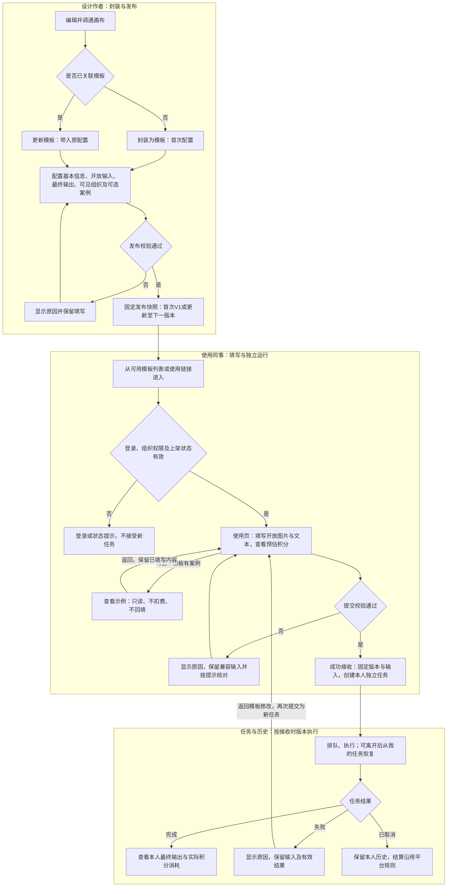

# 先马AI内容与视觉平台｜无限画布｜封装工作流 PRD

## 0. 文档信息

| 项目 | 内容 |
|---|---|
| 文档版本 | V1.1 |
| 文档日期 | 2026-10-13 |
| 需求类型 | 既有无限画布上的增量：新增工作流模板闭环，配套节点命名与模板更新 |
| 产品规则状态 | 本文核心范围已由用户逐项确认，整理为开发评审基线 |
| 原型状态 | 本地可点击原型已制作，已执行部分自动及浏览器回归；不等于全部生产验收通过 |
| 真实服务状态 | 本轮未接入真实模型、服务端鉴权、任务执行、媒体持久化与积分流水；不代表开发完成、部署或上线 |
| 原型基线 | 2026-10-13最终已确认交互；画布入口“更新模板”，节点名称Enter/失焦保存；默认演示模板V2，本地验收更新可出现V3 |
| 版本区别 | 本文V1.1是文档版本；模板V1/V2/V3是各模板发布版本，不是平台版本 |
| 需求来源 | 用户直接协作确认及正式原型交接说明；无本需求REQ，不虚构编号、不自动进入需求池 |
| 本期模块 | 封装工作流；节点命名为其配套画布增量，不重写画布产品 |

### 0.1 变更摘要

#### 封装工作流｜新增、优化、删除

设计将调通的画布封装成组织内可复用模板，同事只填写图片和文本即可独立运行并查看自己的结果。

1. **WF-CHG-01 画布封装**：自动识别输入，配置开放/固定内容、字段名、说明与最终输出，内部直接发布。
2. **WF-CHG-02 节点命名**：节点名可修改；来源名称、类型和编号帮助区分，名称修改不改变节点关联。
3. **WF-CHG-03 更新发布**：已封装入口“更新模板”，回填旧配置，更新版本且地址不变；保存画布不更新模板。
4. **WF-CHG-04 模板发现与治理**：可用模板、我的发布、我的任务；组织授权、链接鉴权、下架和重新上架。
5. **WF-CHG-05 可选示范案例**：从同一发布画布固化输入与最终输出，仅在有案例时展示查看示例，只读且不扣积分。
6. **WF-CHG-06 独立运行**：上传图片、填写文本，展示预估积分；任务与输入输出独立，积分由运行者承担。
7. **WF-CHG-07 本人任务与结果**：恢复任务，查看状态、输入、结果与消耗，失败可返回模板修改。
8. **WF-CHG-08 交互与安全边界**：统一面包屑和图片预览，校验版本、身份与多窗口冲突；删除参考制作链接和链接文案。

### 0.2 修订记录

| 版本 | 日期 | 内容 |
|---|---|---|
| V1.0 | 2026-10-13 | 汇总本轮最终确认，形成封装、更新、授权、示例、运行、任务及验收闭环；不扩展其他模块 |
| V1.1 | 2026-10-13 | 新增整体流程图，移除需求来源与证据、配套交付物章节；业务范围与规则不变 |

## 1. 目标、基线与范围

### 1.1 问题与目标

设计已在画布调通流程，但同事复用仍依赖理解节点、修改素材和联系设计。目标是将流程沉淀为可复用模板，让有权限的同事自行完成提交、查看结果与历史恢复，并确保不同使用者的素材、结果和消耗互不混用。

现有项目/文件夹管理、节点创建与连线、拖动、选择、缩放、撤销重做和素材/历史能力保持原规则。本轮在当前第三版本地原型上增量表达工作流能力，不以原型菜单或模拟生成推断生产节点均可执行。

上线后采集独立完成率、填写至接收耗时、结果可用率与设计协助次数；当前无确认基线或目标数值。

### 1.2 类型与范围

| 类型 | 使用者开放输入 | 选定最终输出 | 本期处理 |
|---|---|---|---|
| 图片 | 支持；每个字段上传一份图片 | 支持 | 沿用平台图片处理与文件约束 |
| 文本 | 支持 | 支持 | 沿用节点文本处理与长度约束 |
| 视频 | 本期不支持 | 支持现有可运行节点 | 实际模型、格式及播放下载需联调 |
| 音频 | 本期不支持 | 本期不支持 | 含未支持节点不得静默发布 |

支持多个最终输出及图文/图视频组合；具体数量与规格沿用既有能力，不承诺任意节点或任意数量。

### 1.3 本次不做

公开市场、售卖、佣金、人工审批、使用者复制或编辑作者画布、模板永久删除、同画布多模板、云端封装草稿、新模型、新音频能力、失败步骤续跑、新退款制度、ZIP/批量下载、智能拆分生产接入。需要另一套模板时先复制画布，再封装；复制能力沿用现有画布规则。

“演示身份”“模拟场景”“有记录/无记录”是验收工具，不进入正式产品页面。默认演示V2、示例20积分、模拟执行时间及演示任务不是生产默认值或业务承诺。

## 2. 封装工作流：用户、入口与完整流程

### 2.0 整体流程

- **保存画布与发布分开**：画布自动保存只保存本地/平台画布，不触发上图的发布动作。已发布模板、案例与历史任务保持原快照。
- **更新不换地址**：已封装画布走“更新模板”，成功后生成下一发布版本，模板ID和使用地址不变；取消或失败不改变原版本。
- **下架与重新上架**：我的发布中下架只阻止新任务；单独重新上架恢复最后成功版本及原地址。若修改后发布，最终操作为“更新并上架”，生成新版本。
- **已接收任务独立**：模板后续更新、下架或撤使用权不改变在途任务和本人历史；费用结算、取消及服务支持的部分成功沿用既有规则。

### 2.1 用户与权限

| 身份 | 可执行操作 | 数据边界 |
|---|---|---|
| 有平台发布资格的设计作者 | 对有编辑权画布封装，管理本人模板 | 模板管理不授予读取他人输入、结果、积分流水的权利 |
| 有组织使用权限的同事 | 从列表/链接进入，查看示例、填写、运行、查看本人任务 | 无原画布编辑、模板配置与组织调整入口 |
| 系统管理员 | 沿用管理员权限管理模板 | 原画布编辑与任务读取仍依平台权限分别校验 |
| 未登录或无权用户 | 登录或查看无权限提示 | 不提前返回正文、固定素材或案例内容 |

发布资格、原画布编辑权、模板管理权、模板使用权、任务读取权分别判断。公司组织树可完整展示，不代表任何人都获得发布或编辑权。

### 2.2 首次封装

1. 设计在有编辑权的画布调通节点与依赖，必要时修改节点名称。
2. 未关联模板时点击“封装为模板”，依次配置基本信息、开放输入、最终输出、检查与发布。
3. 自动获取无上游的图片/文本输入候选；选择开放或固定、业务字段名、必填与说明，设置展示顺序。
4. 选定最终交付节点与展示名称/顺序，配置可见组织，按需勾选示范案例。
5. 点击“发布模板”时自动校验；失败保留配置，底部展示原因；成功创建稳定模板地址和V1。
6. 成功页展示只读使用链接，可复制、查看模板或返回画布。

### 2.3 更新模板

1. 一个画布最多关联一个模板。已关联时入口仅显示“更新模板”，不另加版本/状态标记。
2. 点击后回填旧名称、说明、封面、场景、组织、开放输入、输出、字段名及案例勾选状态，使用当前画布准备新版本。
3. 按节点ID及类型匹配配置：仍兼容的保留旧业务名称；来源显示最新节点名；新增候选默认沿用节点名；删除或类型改变的旧配置提示失效并确认移除。
4. 保存画布只保存画布，不自动更新模板、示例和任务；提示“画布已保存，已发布模板未更新”。
5. 已发布模板最终按钮“确认更新并发布”；已下架模板为“更新并上架”。取消或失败保留原发布状态与版本。
6. 更新成功形成下一发布版本，模板ID与使用地址不变。新任务使用新版本，旧任务继续使用接收时快照。
7. 单独“重新上架”恢复最后成功发布版本，不自动采纳画布修改，不增加发布版本。

### 2.4 同事使用与案例

1. 从可用列表或链接进入，校验登录、组织与上架状态。
2. 有示范案例时展示“查看示例”；点击后只读左右分栏查看发布案例，返回使用页保留本次填写内容。
3. 左侧填写开放图片/文本，查看说明；固定内容、提示词和模型参数不开放修改。
4. 查看预估积分和本人余额，点击开始运行；接收前再次校验当前身份、状态、权限、版本、输入、素材/模型与积分条件。
5. 成功接收形成本人独立任务，进入详情；允许离开页面，之后从我的任务恢复。
6. 无本人运行记录时右侧只展示暂无结果；有记录时展示本人最近任务，不展示旧作者样品。
7. 失败保留输入；返回模板修改仅回填本人该任务中仍兼容的开放输入，不自动启动新任务。

## 3. 封装工作流：页面与交互

### 3.1 画布与封装弹窗

| 区域 | 控件/内容 | 默认、操作及反馈 |
|---|---|---|
| 节点标题 | 可编辑节点名 | 双击或键盘进入编辑；Enter和点击其他位置保存；Esc取消；空白名称拒绝保存。允许重名，通过类型及配置中的编号区分 |
| 画布顶部 | 封装为模板/更新模板 | 是否关联模板决定文案；仅明确发布动作改变模板，不因画布自动保存而更新 |
| 基本信息 | 名称、用途说明、场景、封面 | 名称/说明/封面必填，场景至少一个；新模板名称沿用项目名；封面可选当前画布图片或上传 |
| 开放输入 | 来源名、类型、编号；字段名称、开放、必填、文字说明、排序箭头 | 自动识别，无需画布标记或手填技术key；新候选默认开放、必填；固定内容不在使用页显示 |
| 最终输出 | 勾选输出节点、交付名称、顺序 | 至少一项；支持图片/文本/视频及多结果；不默认交付所有中间节点 |
| 检查与发布 | 公司组织树、可选案例 | 组织支持搜索、展开/收起；新模板默认所属组织，更新保留旧选择；至少一个有效组织 |
| 示例勾选 | 将本次画布作为示范案例，帮助使用者了解输入与输出 | 首次默认不勾选；更新默认沿用有无案例；不新增单独上传/配置示例流程 |
| 右侧预览 | 依赖顺序及选定输出 | 根据节点连线而非位置执行；输入展示排序不改变执行顺序 |
| 固定底部 | 取消、上一步、下一步、发布/更新 | 发布时自动校验并显示原因，提交中防重复；不设独立“检查配置”或“表单预览”按钮 |
| 发布成功 | 系统生成链接、复制、查看模板、返回画布 | 使用链接只读；不存在参考制作链接及链接文案 |

弹窗采用视口级浮层，不被画布或侧栏裁切。桌面配置和预览并列，窄屏顺序堆叠；标题、关闭和底部操作可达。取消未发布配置不改变已发布版本；不新增云端草稿承诺。

### 3.2 列表展示及筛选

三个页签均在无限画布工作流模板内，不新增全站一级模块。使用顶部可点击面包屑，去掉重复返回栏：使用页回来源模板列表，任务详情回我的任务，模块列表回画布项目列表。直接链接进入无来源时使用对应内部列表兜底。示例页保留“返回使用页”。

| 展示项 | 数据来源/所有权 | 空值及可编辑边界 |
|---|---|---|
| 模板封面、名称、用途说明 | 当前成功发布版本 | 发布时必填；列表只读，不以生成新图补空缺 |
| 使用场景 | 发布者配置的场景集合 | 至少一个；展示标签，多选配置、单场景筛选 |
| 作者 | 平台账号及模板归属 | 列表只读，更新不改变作者；账号失效处理沿用平台规则，不转授权限 |
| 发布版本 | 成功发布版本号 | 首次V1，更新递增；下架/组织调整/单独上架不递增 |
| 更新时间 | 最近成功发布或管理修改时间 | 原型当前口径；生产字段映射按同一口径落实，不显示失败修改时间 |
| 发布状态 | 模板管理状态 | 已发布/已下架，不显示审核中、驳回 |
| 我的任务名称、时间、版本 | 任务接收时快照、接收时间 | 只读，后续模板改名/更新不改旧任务展示 |
| 我的任务状态 | 本人任务服务状态 | 排队中、执行中、已完成、失败、已取消；未知状态不得伪装完成 |
| 我的任务积分 | 本人费用预估及实际流水关联 | 预估与实际分别展示；实际未知显示待结算，不填0或虚构退款 |

可用模板仅返回本人有组织使用权且已发布的模板；我的发布返回本人可管理的已发布及已下架模板，管理员按既有权限查看。名称搜索和场景筛选同时生效，筛选栏搜索、场景、数量、进入画布封装按顺序靠左。

列表无数据与无匹配分开显示；列表失败展示重试，不伪装空列表。模板排序/分页沿用平台列表规则；现原型不提供独立排序或分页控件，不新增需求。我的任务按接收时间倒序，默认只展示真实本人记录；生产不得补演示任务。任务列表本期无新增搜索/状态筛选，分页沿用现有任务服务。

### 3.3 我的发布：状态与操作

| 操作 | 显示条件 | 成功结果 | 失败/禁用 |
|---|---|---|---|
| 使用预览 | 有模板管理权 | 进入同一模板使用页；仍校验使用权与状态 | 管理权不绕过组织使用权；已下架不能启动任务 |
| 编辑/更新发布 | 有模板管理权 | 回到来源画布，经“更新模板”打开旧配置 | 无画布编辑权或来源不可用时提示，不能创建伪来源 |
| 可见组织 | 有模板管理权，两种状态均可 | 回填并修改组织，后续列表和新提交采用新范围 | 无有效组织、身份变化、冲突或保存失败时原配置不变 |
| 链接 | 有模板管理权，两种状态均可 | 复制系统生成原地址；访问仍鉴权 | 复制失败提示手动复制；下架链接不是可运行承诺 |
| 下架 | 已发布且有管理权 | 二次确认后变已下架，从可用列表移除 | 取消不变；失败保留已发布 |
| 重新上架 | 已下架且有管理权 | 检查组织、流程与素材有效性，恢复原版本与地址 | 校验/保存失败仍下架，不自动采纳画布改动 |

下架确认文案：“下架后，同事将无法启动新任务；已提交任务继续执行，历史结果保留。”调组织、上下架与更新发布均防重复、重新鉴权，并检测打开配置后是否被其他人/窗口修改。公司组织数据来自现有组织服务，工作流不维护另一套组织；组织查询失败不允许用伪造树扩大权限。

### 3.4 使用、示例、任务与结果

| 页面/区域 | 展示及操作 | 边界 |
|---|---|---|
| 使用页输入 | 按配置顺序展示名称、必填、文字说明；图片上传/预览/替换/清除，文本编辑/放大 | 单字段一张图片，选填空值不恢复他人素材；无参考制作跳转 |
| 使用页费用 | 预估积分、本人余额、开始运行 | 未知费用显示失败及重试；余额不足禁运行；提交中禁重复 |
| 使用页右侧 | 本人最近任务或“还没有运行结果” | 排队/执行显示准备中，失败/取消用专属提示；不把发布样品当本人结果 |
| 示例页左侧 | 同一发布案例输入图片、文本、名称与说明 | 明确“示范案例”及发布版本；只读，不上传/替换/编辑 |
| 示例页右侧 | 选定最终图片、视频、文本，多个结果 | 图片可预览、视频可播放、文本可阅读；沿用结果查看/下载及复制能力，复制内容与展示一致 |
| 示例返回 | 返回使用页 | 不生成任务、不扣积分、不回填案例内容，保留使用者当次填写 |
| 任务详情输入 | 本次输入及字段名称 | 从任务快照读取，只读，不从当前模板重新拼装 |
| 任务详情结果 | 状态、最终输出、预估/实际消耗 | 只展示本人的任务结果；多个输出按接收时顺序，不默认展示中间产物 |
| 任务失败 | 原因、保留输入、返回模板修改 | 兼容字段按ID及类型回填，重提交是新任务；不承诺失败步骤续跑或退款 |

输入图和结果图各用独立集合，复用公共图片预览：左右切换、放大/缩小；单图无多图切换入口。图片点击不得触发生成。视频/文本使用平台既有查看方式；文本显示与复制同一内容。下载沿用类型和访问权限规则，不新增批量打包。

## 4. 封装工作流：业务规则

以下编号承接交接说明WF-R-01—20，并补充最新确认；同一规则引用本文最终口径。

| 编号 | 规则 | 来源/状态 |
|---|---|---|
| WF-R-01 | 内部模板无需人工审核，校验通过直接发布 | 交接2.3，已确认 |
| WF-R-02 | 发布校验基础信息、组织、输入映射、选定输出和流程；错误保留配置并在固定操作区可见 | 交接2.3/14，已确认 |
| WF-R-03 | 缺输出、固定内容、有效路径，失效连线、循环依赖或未支持节点阻止发布；选填空值未经节点兼容验证不能静默执行 | 交接2.3/2.4、当前校验路径 |
| WF-R-04 | 发布固化流程、模型参数、固定内容、输入输出及稳定链接 | 交接2.3，已确认 |
| WF-R-05 | 画布独立保存；只有明确更新发布形成新版本，失败保留旧版本 | 交接2.3/18，已确认 |
| WF-R-06 | 使用者不复制/编辑作者画布；作者继续沿用已有画布编辑入口 | 交接2.3，已确认 |
| WF-R-07 | 工作流展示全公司组织，新模板默认所属组织，更新保持原选择；父组织覆盖当前及未来下级，沿用现有组织算法 | 交接14覆盖早期可授权范围限制，已确认；不改素材库规则 |
| WF-R-08 | 模板使用、管理、原画布编辑和任务读取权独立判断 | 交接3.2，已确认 |
| WF-R-09 | 列表、详情、链接、案例资源和新运行分别校验当前权限，链接不能赋权 | 交接3.2/12，已确认 |
| WF-R-10 | 未登录保留目标进入登录；无权不返回正文和资源；有权但下架明确提示且阻止新任务 | 交接3.2，已确认 |
| WF-R-11 | 作者管理本人模板，管理员按既有权限统一管理；作者不能读取其他使用者任务 | 交接3.2，已确认 |
| WF-R-12 | 下架隐藏可用列表但保留管理记录和原地址；重新上架恢复最后成功版本，需重新校验有效性 | 交接3.3/7，已确认 |
| WF-R-13 | 更新、下架或撤使用权不取消已接收任务，也不删本人历史 | 交接3.3/4.2，已确认 |
| WF-R-14 | 接收前校验必填、状态、当前组织、素材/模型、版本、身份与积分 | 交接4.2及已验证身份修复 |
| WF-R-15 | “已启动”以系统成功接收为准，含排队；打开页面、填写、失败提交不算启动 | 交接4.2，已确认 |
| WF-R-16 | 接收固定模板版本、输入、输出配置、执行参数及运行者，形成独立任务 | 交接4.2，已确认 |
| WF-R-17 | 接收后按原快照和原计费规则执行，主动取消沿用平台既有能力 | 交接4.2，已确认 |
| WF-R-18 | 停留期间契约变更须核对新版再提交；仍兼容输入保留，不静默换版本 | 交接4.2，已确认 |
| WF-R-19 | 运行扣运行者积分，预估、扣费、失败、重试、取消结算沿用现有实际规则 | 交接4.2，已确认；实际服务映射待联调 |
| WF-R-20 | 同一提交请求幂等，不重复收费/创建任务；失败接收不生成成功运行记录 | 交接4.2，已确认 |
| WF-R-21 | 同画布关联一个模板，入口“更新模板”；回填旧配置，更新不改模板ID和地址 | 交接18、用户最终文案，已确认 |
| WF-R-22 | 节点标题Enter/点击外部保存、Esc取消、禁止空名；稳定ID关联，重名用类型和编号辨认 | 交接18及失焦追加，已确认 |
| WF-R-23 | 新候选继承节点名，既有兼容配置保留业务名；删除/类型改变提示并确认移除，无有效路径仍阻止发布 | 交接18，已确认 |
| WF-R-24 | 可选案例必须来自同一发布画布的输入与对应最终输出；缺内容阻止勾选发布，不能混入其他任务 | 交接12，已确认 |
| WF-R-25 | 案例随版本固定；画布后改不改变，更新可取消案例；媒体本体须满足固定快照语义 | 交接12，已确认；不可变媒体是开发责任 |
| WF-R-26 | 有案例且有使用权才展示查看示例；只读、不运行/扣费/回填，返回保留当次输入 | 交接12/17，已确认 |
| WF-R-27 | 右侧只展示本人最近任务，没有时暂无结果；作者样品仅通过示范案例展示 | 交接17，已确认 |
| WF-R-28 | 运行/发布/管理写入前重校验当前身份和权限；配置冲突提示重新打开，不覆盖他人组织或状态变更 | 用户授权修复及自检验证，已确认 |
| WF-R-29 | 删除参考制作链接及链接文案，保留文字说明；系统自动使用链接仍保留 | 交接9/12，已确认 |
| WF-R-30 | 使用统一面包屑及公共图片预览，取消重复返回和重复我的任务入口；验收工具不进入生产 | 交接8/9/13/15/16，已确认 |

## 5. 封装工作流：AI能力契约与兼容

### 5.1 能力契约

本期增加复用与执行入口，不新增通用业务Prompt或为用户自动编排流程。

| 契约项 | 要求 |
|---|---|
| 输入事实源 | 开放项使用本次用户值；固定项使用发布快照；其他缺省值仅按既有节点规则。案例、其他用户输入、作者后来修改的画布不是任务输入 |
| 处理责任 | 任务服务根据连线解析执行依赖并绑定输入；模型链路沿用各节点已发布Prompt、参数和平台能力，不能按画布坐标推断依赖 |
| Prompt业务语义 | 发布Prompt保持固定；用户只修改已开放字段。字段值与固定指令分别绑定，不额外扩展工具权限或加入其他任务上下文 |
| 输出契约 | 返回选定最终输出的节点关联、类型、内容/媒体引用及实际状态，按配置顺序展示；中间产物不自动交付 |
| 成功标准 | 所选交付项均获得对应可用结果，内容归属本任务，类型/格式符合节点配置。不能仅凭模型接口返回成功或复用作者样品判成功 |
| 质量门禁 | 检查输入映射、固定内容、结果类型、非空内容及文件可访问/可播放；各节点已有内容质量规则继续适用，不新建全局AI审核 |
| 失败与重试 | 显示可理解原因，保留任务输入及实际有效结果；模型不可用、超时/限流等沿用现有失败机制。不自动替换模型、重写Prompt或开展额外收费重试 |
| 人工处理 | 用户核对输入后重新提交；不新增人工审核或失败步骤续跑。已有取消/重试能力按平台契约呈现 |
| 部分成功 | 只有现有服务支持时按其状态与结算展示有效结果，不能丢弃成功项或伪装全部完成；当前原型无部分成功演示 |
| 计费与停止 | 沿用现有重试次数、停止、失败/取消结算；接收前未知费用或余额不足不调用模型。不自行规定失败免费或取消全退 |

业务例：上传本人的商品图并填写卖点，用已发布固定风格生成选定场景图与文案。反例：用户没有上传商品图，却从示范案例或上一任务取图；或把封面作为本人的生成结果。这些均不满足验收。

### 5.2 能力矩阵

| 节点能力 | 输入/输出范围 | 实现与限制来源 |
|---|---|---|
| 图片处理/生成 | 开放图片、固定参考与文本依赖；图片输出 | 沿用画布实际模型；数量、格式、尺寸、比例、大小由现有配置确定 |
| 文本处理 | 开放文本及固定Prompt；文本中间处理或输出 | 沿用文本节点；文本长度、结构、空值与质量限制以当前模型契约为准 |
| 视频生成 | 使用已支持固定/上游输入；最终视频输出 | 首期不开放视频上传；模型版本、时长、首尾帧、格式由技术核对，未核实不得声称支持 |
| 音频/智能拆分/特殊节点 | 未确认进入本期执行链 | 不因画布菜单存在就可封装；未支持须阻止，不静默跳过 |

具体模型/版本、供应商接口、节点字段映射由开发回填现有能力矩阵；技术限制若改变已确认用户流程或输入输出范围，须回产品确认。

### 5.3 输入输出兼容

| 场景 | 兼容规则 |
|---|---|
| 同类型节点改名 | 按ID关联不重建连线；已配置业务名保持，来源名称更新 |
| 新节点/删除/变更类型 | 新输入待配置；旧失效项确认移除；已发布版本与旧任务仍按旧快照 |
| 使用者页面停留时更新 | 旧填写不静默提交给新契约，提示核对并保留ID/类型仍兼容字段 |
| 本人失败任务回填 | 只回填本人兼容开放输入；模板无权/下架时仍阻止运行 |
| 更新取消案例 | 新版无查看示例；不改已接收任务，不从历史任务补新案例 |
| 原素材变更/删除 | 已发布固定素材及案例需版本化/不可变引用，不能依赖可变URL导致内容漂移；具体存储机制技术落实 |
| 旧客户端/回滚 | 沿用已有兼容策略；不能支持新契约时不静默启动错误版本，旧任务读取与既有数据保持 |

## 6. 封装工作流：状态、边界与异常

以下机器标识与当前原型一致，仅为建议生产映射，最终沿用服务协议；不新增未知状态业务流程。

| 状态 | 标识 | 页面及操作 | 转移条件 |
|---|---|---|---|
| 未封装画布 | 未关联模板 | 封装为模板 | 首次发布成功关联模板 |
| 已发布 | published | 可授权使用；作者管理/更新/下架 | 下架，或更新形成新版本仍已发布 |
| 已下架 | unpublished | 管理列表保留，新运行禁用 | 单独重新上架恢复旧版；更新并上架形成新版 |
| 提交中 | 客户端状态 | 禁重复提交，不等于任务已启动 | 接收成功进入任务；失败保留填写 |
| 排队中 | queued | 本人任务可查，结果准备中 | 服务开始执行或按既有规则取消 |
| 执行中 | running | 展示真实进度，允许离开 | 服务完成/失败/取消 |
| 已完成 | succeeded | 展示本任务选定输出及实际消耗 | 历史只读，后续模板变化不改快照 |
| 失败 | failed | 显示原因，保留输入与有效结果，可返回修改 | 重新提交产生新任务，不改原失败记录 |
| 已取消 | cancelled | 显示取消状态并保留输入与历史 | 不展示仍在准备中；计费按平台流水 |
| 部分成功 | 沿用已有服务枚举；映射待技术核对 | 服务支持时显示有效结果及失败项 | 沿用服务契约，原型未验证 |

| 边界/异常 | 处理及反馈 | 数据与费用影响 |
|---|---|---|
| 基础信息/组织/输出缺失 | 发布阻止，底部指出原因，保留配置 | 旧版本不变，不创建新发布版本 |
| 无效图、循环、空固定内容、节点不支持 | 指向对应节点，要求修正 | 不假装发布成功，不触发生成补齐 |
| 选填空值下游不支持 | 提示设为必填/固定或调整流程 | 不恢复上一用户内容 |
| 上传读取失败或超规格 | 提示有效格式/大小要求，可重新选择 | 保留其余输入；规格沿用现有上传限制 |
| 案例缺输入或最终结果 | 提示准备画布内容或取消案例勾选 | 不从其他任务补内容，不因勾选自动生成 |
| 未登录/无权/已下架/不存在 | 明确对应状态；未登录保留目标 | 不接受新任务；无权不暴露资源 |
| 余额不足/预估失败 | 禁运行；费用失败可重试，未知不显示0 | 不调用模型或创建收费任务 |
| 点击重复/网络返回不明 | 客户端锁定，服务按同一请求幂等 | 不重复创建/收费，失败不显示运行成功 |
| 提交期间切换身份或退出 | 保存前重校验，拒绝旧身份写入 | 不把任务或模板归给错误用户 |
| 配置被其他窗口修改 | 组织/状态/版本/修订冲突提示重新打开 | 保留已成功修改，失败方不覆盖 |
| 原画布保存/模板更新 | 画布与模板独立；更新才替换当前可用版本 | 旧任务及旧案例快照不被改写 |
| 下架/撤权发生在任务接收后 | 新提交拒绝，已接收任务按原快照执行 | 本人历史保留，积分沿用原任务规则 |
| 任务失败/取消 | 专属状态，不显示准备中；保留输入 | 不虚构结果、退款或续跑 |
| 列表/管理网络失败 | 可重试；管理失败提示原配置未改 | 不能伪装空列表或成功保存 |
| 原素材或视频访问失败 | 展示真实资源错误，不用封面替代结果 | 案例媒体固定语义需后端落实，不宣称URL深复制已解决 |

## 7. 封装工作流：业务字段与快照

字段名是产品与技术对齐建议，不是已存在接口/建表设计；实际账号、组织、素材、模型任务、积分流水与历史对象沿用现有结构。未确认长度/格式上限由现有平台约束提供，若无既有值需技术提出并经产品确认，不能擅自使用演示值。

| 对象/字段 | 类型 | 必填 | 默认、范围、格式及校验 |
|---|---|---|---|
| 模板 templateId | 稳定标识 | 是，系统生成 | 首次创建；更新/上下架不变；格式沿用平台ID |
| 模板 sourceCanvasId | 画布引用 | 是 | 当前有编辑权画布；一个画布一个模板；不以项目名称判断关联。原型用项目ID代替单画布ID，生产按真实画布对象绑定 |
| 模板 authorId | 账号引用 | 是 | 创建时归属；更新不变；不得用前端演示身份代替认证 |
| 模板 name | 文本 | 是 | 首次默认项目/画布名，可改，去空白后非空；长度沿用现有命名约束 |
| 模板 description | 文本 | 是 | 默认空，用途说明，非空；长度沿用现有约束 |
| 模板 scenes | 场景标识集合 | 是 | 至少一项；沿用平台场景配置，不把演示标签作为封闭生产枚举 |
| 模板 cover | 素材引用 | 是 | 默认可用画布图，允许选择/上传；格式大小沿用上传服务；不是最终结果 |
| 模板 orgIds | 组织引用集合 | 是 | 新建默认所属组织；至少一有效组织；更新默认旧值；父子覆盖复用现有算法 |
| 模板 status | 发布状态枚举 | 是 | 成功首次发布为published，已下架unpublished；不新增审核态 |
| 模板 currentVersion | 正整数 | 是 | 首次1，成功更新加1；下架/权限调整/单独上架不加1 |
| 模板 updatedAt/修订凭据 | 时间/修订引用 | 是 | 成功修改更新，失败不变；格式和冲突凭据沿用现有服务，不指定数据库实现 |
| 使用地址 useUrl | 系统生成地址 | 是，系统生成 | 关联templateId，用户不填写，更新不改变 |
| 发布版本 graphSnapshot | 流程快照 | 是 | 节点ID/类型/连线/Prompt/参数/固定内容，发布成功固化；执行字段沿用节点结构 |
| 输入 nodeId/type | 节点标识及类型 | 是 | 自动识别；图片/文本；同ID且同类型才兼容；ID不因改名变化 |
| 输入 label | 文本 | 是 | 新节点沿用节点名，旧配置保留业务名，非空；长度沿用字段约束 |
| 输入 open/required | 布尔 | 是 | 新候选默认true/true；固定项不开放，选填需空值兼容验证 |
| 输入 help/order | 文本/展示序号 | 说明否、顺序是 | 说明默认空；序号由排序产生；不改变执行依赖；不保存参考制作链接 |
| 输出 nodeId/type/label/order | 关联/类型/名称/顺序 | 是 | 至少一项；有效可执行图片/视频/文本，名称非空；默认节点名，旧配置保留 |
| 案例 includeExample | 布尔配置 | 是 | 首次false；更新沿用旧版是否有案例；关闭时新版无案例 |
| 案例 exampleCase | 版本快照或空 | 勾选时是 | 同一发布画布的输入、名称、说明、选定最终结果及版本，取消时为空；不得混其他任务 |
| 案例 mediaReferences | 素材版本引用 | 有媒体时是 | 保证内容不可被原素材后续覆盖/删除而漂移；格式、保留机制由媒体服务核实 |
| 任务 taskId/requestId | 任务与提交关联标识 | 是，系统生成 | 接收产生任务ID；相同本人提交请求幂等；具体格式沿用任务服务 |
| 任务 ownerId/templateId/version | 账号/模板/版本引用 | 是 | 服务认证的运行者、接收时模板及版本；不可由前端篡改 |
| 任务 inputSnapshot/outputConfig | 输入值及输出配置快照 | 是 | 接收固定，固定项取发布版本，开放项取本人本次填写；格式和媒体约束沿用节点 |
| 任务 startedAt/status/results | 时间/状态/结果集合 | 接收时间状态是，结果随进展 | 状态来自服务；结果关联任务与输出节点，非本任务素材不能混入 |
| 任务 estimatedCost/billingReference | 数值/流水引用 | 预估已知才接收；流水按服务 | 单位积分，不固化演示20；结算未知显示待结算；沿用积分对象结构 |
| 节点 title | 文本 | 是 | 初始节点类型名称，可改；trim后非空，允许重名；上限沿用节点命名约束 |

快照时机：发布成功固定版本及案例；任务接收固定本次执行契约；执行结果与流水只更新其自身任务。模板管理操作改变当前可访问状态，不重写历史发布或本人任务内容。

历史数据兼容：原模板无案例则无按钮，不从历史任务自动造案例；旧任务继续按其版本读取。原型将完全匹配旧默认演示模板的V1升级为含案例V2，是测试数据修正，生产不应用该迁移策略。

## 8. 封装工作流：责任边界与公共能力影响

| 责任方/能力 | 本期对接责任 | 沿用与变化 |
|---|---|---|
| 前端 | 画布命名与入口、封装弹窗、组织选择、示例、填写、任务、预览、错误与版本反馈 | 复用现有UI、公共图片预览和组织组件；不重建画布框架 |
| 发布/任务服务 | 唯一画布关联、发布快照、链接、组织及状态管理、冲突、独立任务、幂等和后台持续执行 | 新增工作流关联/快照语义，接入现有节点执行体系 |
| AI模型链路 | 实际节点兼容、输入绑定、已发布Prompt/参数、生成、质量与失败返回 | 沿用原画布节点，不新增全局Skill或任意模型替换 |
| 账号与组织 | 认证、发布资格、组织使用权、管理/画布/任务权限及组织失效判定 | 复用组织树/父子算法；工作流选择全公司；素材审批和其可授权范围不变 |
| 素材/媒体服务 | 上传、固定素材可访问性、不可变案例/发布媒体、权限内预览下载 | 复用素材结构；本期必须落实发布固定内容语义，不用可变URL冒充快照 |
| 积分服务 | 本人余额、预估、接收/执行扣费、流水及失败/取消/重试结算 | 沿用实际规则，不另建计费制度 |
| 历史/下载 | 本人任务归属、快照恢复、已有类型下载 | 工作流内保留我的任务，不以全站历史替代；不扩展ZIP/删除能力 |

生产任务后台持续执行不能由浏览器计时器替代。并发、排队上限、超时、数据保留周期、文件规格、权限同步失败回退均沿用现有服务配置；无法找到现有契约时进入技术核对，不编造数值。原型与旧备份入口保持，不要求同步重写其他静态原型或其他AI业务页。

## 9. 封装工作流：验收标准

本表是待执行的完整业务验收矩阵，不能因已有18项逻辑测试通过就认定全部已通过。正常、边界、异常、历史兼容及真实服务须按条件分别取证。

| 编号 | 关联规则 | 前置条件 | 操作步骤 | 可观察预期 | 类型 |
|---|---|---|---|---|---|
| WF-AC-01 | WF-R-01/02/04 | 有权且未封装的有效画布 | 配置基础信息、输入、输出、组织后发布 | 无审核，创建V1与只读使用链接，返回保留节点/视口 | 正常 |
| WF-AC-02 | WF-R-02/03 | 缺组织/输出或有循环/失效连线 | 分别点击发布 | 固定底部列原因，配置保留，不新建版本 | 边界 |
| WF-AC-03 | WF-R-03/29 | 两根输入、一固定参考、多中间节点 | 打开输入配置，排序/改业务名并发布 | 自动绑定根图片/文本，无手填key，中间节点不开放，无参考链接字段 | 正常 |
| WF-AC-04 | WF-R-03/16 | 固定内容为空或选填空值下游不支持 | 发布/提交 | 明确阻止，不补他人素材；修正后才允许 | 边界 |
| WF-AC-05 | WF-R-22 | 已有节点及连线 | 改名，分别Enter、点击空白、点击工具、Esc、输入空名 | 保存动作一致，Esc还原，空名不保存，ID/连线/依赖不变 | 交互 |
| WF-AC-06 | WF-R-21/23 | 已封装且原字段有业务名 | 改来源名、再次点击更新模板 | 入口“更新模板”，回填原配置，来源新名，业务名原值，编号可区分重名 | 正常 |
| WF-AC-07 | WF-R-05/25 | 已发布且有案例 | 修改并保存画布，打开旧模板/案例 | 仍原发布版本与案例，画布保存提示未更新模板 | 兼容 |
| WF-AC-08 | WF-R-04/05/21 | 已关联模板且地址已记录 | 修改配置并更新成功/取消/模拟失败 | 成功版本递增且地址相同；取消/失败旧版与状态不变，无重复模板 | 正常/异常 |
| WF-AC-09 | WF-R-23 | 旧配置节点已删除或类型变更 | 打开更新并尝试发布，再确认移除 | 明确列失效配置，未确认阻止；确认后保留兼容项，无输出仍阻止 | 边界 |
| WF-AC-10 | WF-R-07/09 | 公司组织树与发布资格有效 | 新建/更新，选择父组织并查看不同部门列表 | 新默认所属，更新保持旧选，全部组织可选；父下级可用，无权部门不可用 | 权限 |
| WF-AC-11 | WF-R-08/09/10 | 无权/未登录身份及有权链接 | 从列表、直接链接、案例地址访问 | 无权不返回正文/资源，未登录保留目标，登录后重校验 | 安全 |
| WF-AC-12 | WF-R-08/11 | 作者、普通同事、管理员 | 分别打开我的发布和他人任务链接 | 管理范围正确；普通同事无管理入口，作者不能读取他人任务 | 安全 |
| WF-AC-13 | WF-R-12/13 | 已发布，有已接收任务 | 下架，访问列表与旧链接 | 二次确认，列表隐藏、新运行拒绝，旧任务和历史保留 | 兼容 |
| WF-AC-14 | WF-R-12/21 | 已下架，画布有未发布修改 | 单独重新上架，再更新并上架 | 单独上架原版本/地址且不用新画布；更新按钮明确，成功才加版本 | 状态 |
| WF-AC-15 | WF-R-28 | 两窗口打开同一配置 | A改组织/状态，B更新发布或保存管理 | B被拒绝并提示重新打开，A内容不被覆盖 | 并发 |
| WF-AC-16 | WF-R-14/28 | 正在运行提交/发布/保存 | 等待期间换身份或退出 | 服务拒绝旧身份写入，不创建错误归属记录 | 安全 |
| WF-AC-17 | WF-R-24/25 | 当前画布输入与输出齐全 | 勾选案例发布；修改原画布再查看 | 同版本同画布输入输出固定，不混其他任务，不受后改影响 | 正常 |
| WF-AC-18 | WF-R-24/26 | 不勾选或案例缺输入/结果 | 分别发布和打开使用页 | 未勾选无按钮；缺案例内容勾选发布被阻止，可取消勾选 | 边界 |
| WF-AC-19 | WF-R-26/27 | 有案例且使用者已填写 | 查看示例，预览图片/播放视频/读文本，返回 | 左右分栏、只读、无运行操作，不扣费/回填，填写保留，右侧不出现旧作者样品 | 交互 |
| WF-AC-20 | WF-R-14/16 | 开放图片/文本及固定内容 | 填写并运行，多人分别使用 | 仅开放项可改，任务输入/结果/积分分别归本人，固定项按版本取值 | 正常 |
| WF-AC-21 | WF-R-14/19 | 必填空、余额不足或费用失败 | 尝试运行、费用重试 | 空值提示对应字段，余额不足/费用未知不接收；重试保留填写 | 异常 |
| WF-AC-22 | WF-R-15/20 | 正常填写，接收响应延迟 | 连续点击并重发同一提交 | 只接收一个本人任务/收费请求；失败不增加已启动计数 | 幂等 |
| WF-AC-23 | WF-R-13/17/18 | 页面停留或任务执行中 | 更新/下架/撤权后提交或看旧任务 | 新提交重校验，版本变更保留兼容输入；已接收任务继续原契约 | 兼容 |
| WF-AC-24 | WF-R-16/17 | 已接收任务 | 离开、关页、刷新，再进我的任务 | 找回同一任务；生产服务后台继续，快照版本/输入不变 | 恢复 |
| WF-AC-25 | WF-R-16/27 | 失败/取消/无本人记录 | 打开使用页及详情 | 无记录暂无结果；失败/取消专属状态，不显示准备中或作者结果 | 状态 |
| WF-AC-26 | WF-R-16/18 | 本人失败任务且模板仍可用 | 返回模板修改，再提交 | 兼容输入回填；新任务独立，旧失败任务不变，不触发自动运行 | 兼容 |
| WF-AC-27 | WF-R-16/30 | 任务包含多个选定图文/视频输出 | 查看、左右切换/缩放、下载及复制文本 | 仅选定结果按顺序展示，公共预览可用，复制等于展示；视频有效可播 | 结果 |
| WF-AC-28 | WF-R-19 | 真实积分服务及成功/失败/取消任务 | 查看预估、实际流水及重试 | 费用由本人承担，实际与流水一致，不编造免费/退款；沿用结算 | 真实联调 |
| WF-AC-29 | WF-R-25/09 | 已发布媒体并有访问权 | 改/删原素材、撤权，访问案例和新任务 | 案例固定内容不漂移，资源权限正确，任务有效性校验真实执行 | 媒体联调 |
| WF-AC-30 | WF-R-30 | 列表/使用/任务/直接链接 | 用面包屑及案例返回 | 返回对应上一层，无重复返回栏；案例返回保留填写 | 交互 |
| WF-AC-31 | WF-R-02/28/30 | 列表失败、管理保存失败 | 切场景并重试/确认保存 | 失败确有变化，列表可重试，管理原数据不变；生产无模拟工具 | 异常 |
| WF-AC-32 | WF-R-30 | 桌面、1280、1024及窄屏 | 开弹窗/预览、滚动、Esc、关闭 | 不被画布/侧栏裁切，标题操作可达，不溢出；关闭返回上下文 | 响应式 |
| WF-AC-33 | WF-R-06/22 | 原项目/画布及旧备份入口 | 创建、改名、返回、拖动、连线、缩放、撤销重做、刷新 | 原能力与数据保留，节点名保存不改变执行关系 | 回归 |
| WF-AC-34 | WF-R-14/16/17 | 真实图片/文本/视频能力与异常样本 | 执行多步骤及多输出，触发超时/失败/服务支持的部分成功 | 真实生成并按服务状态返回有效结果，非作者样品；中间/最终归属正确 | 真实联调 |

### 9.1 变更—规则—验收追踪

| 变更 | 对应规则 | 对应验收 | 原型/证据 |
|---|---|---|---|
| WF-CHG-01 | WF-R-01—04、WF-R-07、WF-R-29 | WF-AC-01—04、10 | 画布封装弹窗、交接2及9/14 |
| WF-CHG-02 | WF-R-22/23 | WF-AC-05/06/09/33 | 节点标题、交接18及失焦追加 |
| WF-CHG-03 | WF-R-05/06/12/21/23/28 | WF-AC-07—09、14—16、23 | 更新模板、我的发布、更新发布浏览器记录 |
| WF-CHG-04 | WF-R-07—13 | WF-AC-10—14/23 | 三页签、组织选择、交接3及7/14 |
| WF-CHG-05 | WF-R-24—27 | WF-AC-17—19/25/29 | 查看示例、交接12/17 |
| WF-CHG-06 | WF-R-14—20/28 | WF-AC-16/20—24/28/34 | 使用页、任务接收规则、自动回归 |
| WF-CHG-07 | WF-R-08/11/13/16—19/27 | WF-AC-12/13/20/23—29/34 | 本人任务及详情、模拟验收 |
| WF-CHG-08 | WF-R-02/28—30 | WF-AC-02/03/15/16/27/30—33 | 面包屑/公共预览/固定底部错误、逻辑自检 |

### 9.2 当前证据与验收边界

- 18项规则/画布自动化回归通过；近期实现lint零错误、5条既有图片警告，生产构建通过。仅证明相关代码检查，不代表真实模型/扣费已接入。
- 浏览器已有证据覆盖模拟列表/管理失败、费用与余额异常、任务失败、输入回填、未登录、案例返回保留、更新原地址、节点改名和失焦保存。
- 真实视频、不可变媒体、服务端鉴权/幂等/并发、后台持续执行、真实计费与部分成功尚需联调；新增节点删除确认及下架更新组合不能仅用代码检查判已验收。
- 验收人由产品/研发/测试按实际职责执行；视频与多输出使用授权素材包逐项取证，不将图片占位当视频成功。

## 10. 封装工作流：效果衡量

以下为产品验证口径，具体事件字段沿用埋点规范，由开发对接，不扩展为新的统计后台。

| 目标 | 事件与口径 | 基线/目标 | 复盘用途 |
|---|---|---|---|
| 设计资产复用 | 发布成功、更新成功；有独立同事任务的模板/有效模板 | 上线后采集，未指定目标值 | 是否沉淀可重复使用流程 |
| 同事自行完成 | 使用页进入、任务成功接收、任务业务完成；按本人去重关联 | 上线后采集 | 完成转化与卡点 |
| 操作效率 | 使用页进入到成功接收时间；设计协助次数由业务记录 | 当前无基线 | 对比人工改画布协作 |
| 结果质量 | 业务完成/接收任务，结果可用反馈，严重输入/归属错误 | 按真实业务样本采集 | 不用模型接口成功代替结果可用 |
| 示例帮助 | 查看示例、返回使用、随后接收/完成任务 | 上线后采集 | 验证是否降低填写错误 |
| 成本可见 | 本人接收任务预估与实际流水对应 | 沿用积分服务 | 异常计费与成本偏差排查 |

## 11. 技术核对、联调与交付

### 11.1 开发需核对的既有契约

| 项目 | 技术需提供内容 | 未落实影响 |
|---|---|---|
| 节点能力矩阵 | 已上线图片/文本/视频节点、模型版本、映射、数量/尺寸/时长/格式和空值约束 | 不能承诺任意画布可执行 |
| 认证与组织 | 发布资格、全公司选择、父子覆盖、组织失效/同步失败、画布与任务读取权限 | 权限不能只依赖前端下拉或隐藏控件 |
| 素材持久化 | 固定内容/案例媒体不可变版本、访问策略、删除与保留周期 | URL深复制不足以实现案例固定 |
| 任务与并发 | 接收快照、幂等、冲突凭据、队列、超时、取消/重试/部分成功与恢复 | 不能用计时器或localStorage替代服务 |
| 积分协议 | 多节点预估、收费时机、失败/取消/重试结算与流水 | 不得使用演示费用，必须验证本人归属 |
| 通用约束 | 名称/文本上限、上传规格、分页排序、保留与客户端兼容 | 复用既有规则；无契约时提出具体值并由产品确认 |

以上是既有能力接入核对，不是重复要求用户确认已决定的业务规则。若核对结果改变本期范围、权限、计费或成功标准，再明确差异退回产品，不由技术或PRD自动补规则。

### 11.2 联调与上线门禁

发布/任务服务联通账号组织、画布节点、媒体、积分、历史与下载后，执行第9节矩阵，重点覆盖两人同模板、多窗口更新、任务执行中下架/撤权、同请求重试、真实视频、多结果与案例媒体变化。

上线条件：没有阻断核心流程或越权/归属/重复收费缺陷；受影响规则均有真实服务证据；原型占位不得发布为真实结果。上线结论需另行验收记录，不由本PRD形成推断。

### 11.3 已知限制与回滚影响

本地原型只模拟任务与积分，资源引用不是不可变媒体存储，视频样本尚未完整验证；这些是实现边界，不是用户可见产品免责声明。生产页面不得保留演示身份、假任务、固定模拟耗时或“接口未接入”等文案。

回滚优先关闭新增入口，不删除既有画布、模板版本及本人历史；在途任务仍遵守接收时契约。具体服务/数据库回滚方案由技术制定，不能用清空本地数据代替生产回滚。平台原画布、素材、积分制度不因本需求重置。

