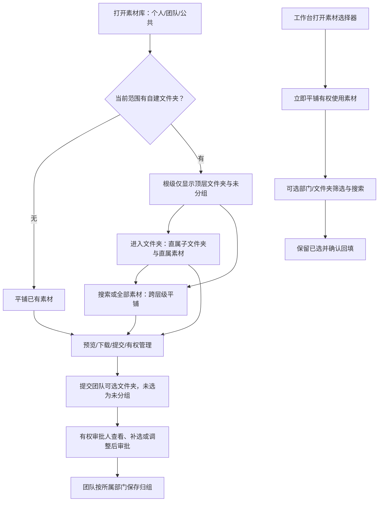

# 无限画布与素材库功能优化 PRD

## 0. 文档信息

| 项目 | 内容 |
|---|---|
| 所属平台/模块 | 先马 AI 设计平台 / 无限画布、素材库及工作台素材选择器 |
| 需求类型 | 图片节点新增角色四视图能力；视频设置调整Gemini Omni可选时长；图片节点模型与规格记忆延续；视频节点画面展示与画布内播放；素材库分组与查找优化 |
| 文档版本/日期 | V1.11 / 2026-10-20 |
| 产品规则 | 已确认；本文件整合既有确认，不新增独立能力 |
| 原型状态 | 角色四视图本地交互及固定样图流程已验证，待用户整体验收；素材库精简交互及部门树已完成本地原型验证并获用户确认 |
| 真实服务状态 | 平台模型接入、真实任务联调、素材库分组服务与权限联调、生产验收及本期上线未完成；素材库既有上线能力不代表本期增量上线 |
| 需求来源 | 用户2026-10-19至2026-10-20多轮确认、素材库已确认分组规则及当前原型；本次未提供REQ编号，不虚构REQ |
| 对应原型 | [无限画布第三版](http://localhost:3003/ai-canvas?project=p1&canvas=beef)，2026-10-20版本；[素材库](http://localhost:3002/materials)及工作台素材选择弹窗；localhost需本机服务运行 |
| 开发交付物 | 本PRD＋对应可点击原型；本期新增/调整规则、提示词和验收在本文定义，未变更的平台能力沿用现有规则 |

### 修订记录

| 版本 | 日期 | 内容 |
|---|---|---|
| V1.0 | 2026-10-20 | 整合角色四视图提示词交接、四视图入口、参考图、补充提示词、占位文案、比例锁定、节点回填、记录及验收规则 |
| V1.1 | 2026-10-20 | 面向开发统一命名为“角色四视图提示词”，移除测试批次编号；正文及业务规则不变 |
| V1.2 | 2026-10-20 | 明确仅交付原型＋PRD；文档独立承载功能规则、提示词、数据及验收，不依赖外部交接和测试文档 |
| V1.3 | 2026-10-20 | 新增视频设置Gemini Omni时长3–10秒的选项、校验、历史兼容及验收 |
| V1.4 | 2026-10-20 | 新增图片模型/规格跨画布记忆、已有节点隔离、生成快照保护及四视图例外 |
| V1.5 | 2026-10-20 | 新增视频节点封面/首帧展示、画布内播放暂停及加载失败反馈要求 |
| V1.6 | 2026-10-20 | 需求概述改为先一句话说明本次功能，再按四项需求说明用户结果；业务范围不变 |
| V1.7 | 2026-10-20 | 按四项需求分别形成完整章节，整体说明与跨需求联调分离；业务规则不变 |
| V1.8 | 2026-10-20 | 合并素材库分组与查找优化，按功能独立成章；同步概述、变更摘要、数据、验收及整体联调。既有四项无限画布规则不变 |
| V1.9 | 2026-10-20 | 补齐目录管理弹窗、浏览状态切换、私人分组计数、审批与选择器细节及专项验收；用户确认单张回显原目录、批量默认保留；混合权限删除策略待确认，不扩大实现范围 |
| V1.10 | 2026-10-20 | 确认附带删除采用整次成功或整次不变；权限、状态或执行失败均不删除目录和素材，刷新后重试；补充专项验收并关闭MAT-DEC01 |
| V1.11 | 2026-10-20 | 同步归组默认值、库来源保留已选和附带删除整次校验的本地原型；记录22项测试及浏览器复查结果，不扩大到服务端验证 |

## 1. 本期需求概述

### 1.1 需求概述

**本次对无限画布新增角色四视图生成和图片参数跨画布记忆能力，并优化Gemini Omni视频时长选择及视频节点内的画面展示与播放；素材库新增三层分组、部门树与文件夹优先浏览，并优化查找、归组及工作台素材选择。**

| 需求点 | 需求描述 | 用户收益 |
|---|---|---|
| 角色四视图生成 | 用户选择角色参考图后，一键生成包含面部近景、正面、侧面和背面全身的合图，支持补充提示词，结果回填当前图片节点 | 无需反复编写四视图提示词，便于统一角色设定 |
| 图片参数记忆延续 | 新图片节点跨画布沿用用户最近设置的模型、分辨率、比例和张数；已有节点及历史结果参数独立保留 | 减少重复设置，不影响历史创作 |
| Gemini Omni视频时长 | 将可选时长从4s、6s、8s、10s扩展为3–10秒、每1秒一个选项 | 提供更细的时长选择 |
| 视频节点展示与播放 | 视频生成后直接显示封面或有效首帧，支持在画布节点内播放和暂停 | 无需进入预览即可查看视频内容 |
| 素材库分组与查找 | 个人、团队、公共素材按文件夹整理，团队按部门独立管理；简化工具栏与卡片，保留跨层级搜索和工作台平铺选择 | 方便运营归档和查找团队素材，减少页面层级与重复操作 |

角色四视图的具体规则见第2节；图片参数记忆见第3节；视频时长见第4节；视频节点展示与播放见第5节。素材库分组与查找见第6节。各项验收以对应章节为准。

### 1.2 范围与边界

本次包含五项需求：第2节角色四视图生成、第3节图片参数记忆延续、第4节Gemini Omni视频时长调整、第5节视频节点展示与播放优化、第6节素材库分组与查找优化。图片提示词卡片以当前已确认原型为交互依据，保持现有页面结构。

本次不做：四张独立图片自动拆分、Skill编排或安装、自动AI质检系统、独立审核后台、批量角色任务、新计费方案、全画布改版。本次保留生成记录和人工验收记录要求，不因要求记录状态而新增用户审核弹窗。普通生图能力按既有逻辑，不把演示的模型列表或多张输出写成新接入承诺。

### 1.3 本期变更摘要

#### 无限画布｜新增角色四视图

用户在关联角色参考图的目标图片节点上选择角色四视图，生成一张面部近景与正、侧、背全身合图，直接回填当前目标节点。

1. **入口与参考图**：图片提示词卡片增加设定图→角色四视图；沿用节点关联图片作为生成输入，多图时选择一张角色图。
2. **可选补充提示词**：角色四视图提示词在底层调用，用户仍可输入补充内容；空输入只调用默认正文，非空按默认正文＋用户补充组装。
3. **固定输出与展示**：单张1536×1024、3:2，四视图期间规格不可改；节点沿用现有展示尺寸并等比完整显示，下载使用原图。
4. **模式联动与结果记录**：退出恢复普通参数、保留输入；生成回填原目标节点、保留历史版本；记录每次实际提示词、参数、输出及生成/验收状态。

#### 无限画布图片设置｜新增模型与规格记忆延续

新图片节点跨画布沿用用户最近的模型与规格设置，已有节点和历史结果保留各自参数。

1. **新节点沿用最近设置**：同一用户最近设置的图片模型、分辨率、宽高比、生成张数，在同画布及其他画布的后续新增图片节点中作为初始值。
2. **历史参数独立**：已有节点保留自身参数，历史生成结果保留当次快照，不被最新默认值覆盖。
3. **更新与例外**：用户修改合法参数后立即记忆，无需成功生成；提示词与参考图不继承，四视图模式不覆盖普通图片默认参数。完整规则见第3节。

#### 无限画布视频设置｜调整Gemini Omni时长

用户在无限画布使用Gemini Omni生成视频时，可按1秒步长选择3–10秒的生成时长。

1. **时长范围**：选择Gemini Omni时，可选时长为3–10秒，即3s、4s、5s、6s、7s、8s、9s、10s。
2. **适用边界**：仅调整该模型的时长选择及提交校验，其他视频模型和设置沿用现有规则。完整规则与验收见第4节。

#### 无限画布视频节点｜优化画面展示与节点内播放

视频生成后在节点内直接显示视频画面，并支持原位播放和暂停，无需先打开放大预览。

1. **直接呈现画面**：视频生成后，节点展示真实视频封面或可展示首帧，避免只显示无反馈的黑色区域。
2. **画布内播放**：在视频节点内即可播放、暂停，无需进入放大预览；保留原有预览和下载入口。完整规则见第5节。

#### 素材库｜新增分组并优化查找与展示

个人、团队、公共素材统一通过最多三层文件夹整理；团队按所属部门独立管理，工作台仍直接展示平铺素材，避免逐层查找。

1. **MAT-CHG-01 文件夹浏览与部门定位**：文件夹优先首页、直属内容浏览、含子级数量、部门树、跨层级搜索及全部素材；无文件夹兼容旧列表。
2. **MAT-CHG-02 页面展示精简**：响应式合并工具栏、折叠筛选、按需批量栏和精简卡片，同步个人、团队、公共素材。
3. **MAT-CHG-03 分组管理与审批归组**：保留私人分组，明确部门和公共管理权限；提交与审批可选文件夹，发布后支持同部门归组。
4. **MAT-CHG-04 文件夹删除**：删除目录默认素材回未分组；仅有删除权限者可另行确认同时删除团队投影，不影响个人或公共素材。
5. **MAT-CHG-05 工作台素材选择**：保持平铺图库，支持可选部门/文件夹筛选、路径搜索、父文件夹含子级及保留已选素材。

## 2. 角色四视图生成

用户在目标图片节点选择关联角色参考图，即可生成一张面部近景与正、侧、背全身合图，并在当前节点查看和下载。

### 2.1 需求说明与入口

- 用户沿用现有无限画布访问权限及图片生成资格；项目、画布和资产访问范围不扩展。
- 单选目标图片节点，打开节点下方“图片提示词”卡片，底部“设定图”选择“角色四视图”。
- 目标节点需要存在入向关联且有有效图片内容的参考节点。目标本身的已有结果不能自动代替关联参考图。
- 多张有效入向图片时，用户需明确选择其中一张作为本次角色参考；未选或选择失效不能提交。不默认合并多个人物参考。
- 生成输入缩略图支持预览、移除和从画布添加参考内容；加减对应真实连线。文本关联可保留在画布，但不替代角色图、不自动拼入本次用户补充内容。
- 文件格式、大小、访问有效性及文本长度限制沿用平台现有上传和生成校验，模型供应商的更严限制由开发联调核实，不在本PRD发明新上限。

### 2.2 用户流程与界面交互

#### 2.2.1 用户流程

1. 将角色参考图关联到目标图片节点，打开目标节点图片提示词卡片。
2. 在设定图中选择角色四视图；显示可移除的模式标签，规格切换为3:2、1536×1024、1张。
3. 多个图片参考时选择一张；可选填补充提示词或使用放大编辑。
4. 点击卡片生成箭头或节点生成按钮；系统进行相同资格校验并提交当次快照。
5. 目标节点显示生成中，阻止同节点重复提交；完成后回填该节点并增加结果版本。
6. 用户检查四个视角，可预览、切换历史结果或下载原图；不合适时调整输入后再次生成。

#### 2.2.2 界面交互与文案

| 区域/控件 | 交互与反馈 |
|---|---|
| 图片提示词卡片 | 保留标题、关闭、生成输入、提示词输入、放大编辑、模型、图像设置、设定图及生成箭头；卡片跟随选中节点，关闭不清空草稿 |
| 角色四视图标签 | 点击移除退出模式；生成期间不可切换，避免任务与当前显示参数混淆 |
| 输入框占位文案 | “基于关联角色图，生成面部近景、正面、侧面和背面全身合图。”；仅空输入显示，输入后消失，不单独显示说明段落 |
| 输入框/放大编辑 | 两处同步用户输入，不展示完整默认正文；占位文字不是输入值，不发送给模型；聚焦边框完整可见 |
| 提示词模板 | 四视图期间保持禁用；本次只开放手动补充输入，防止模板替换默认正文 |
| 图像设置 | 四视图显示3:2、1张及锁定标识，说明“角色四视图固定 1536 × 1024 · 3:2 · 1 张”；分辨率/比例/张数不可更改 |
| 模型选择 | 复用既有选择器；可用模型须通过本能力兼容联调，不承诺演示列表全部可用 |
| 缺少有效参考 | “请先关联角色参考图”，所有生成入口禁用 |
| 多图未选 | “请选择一张关联角色参考图”，所有生成入口禁用 |
| 生成中 | “正在生成角色四视图…”；输入、规格、模式及同节点生成入口禁用 |
| 失败 | 保留输入和原有成功结果，展示平台对应失败原因，提供重试；不使用“换示例图”作为生产文案 |

卡片遵循当前项目视口限制和顶层浮层规则；窄屏、短屏正文内部滚动，头部及生成操作保持可达。验证桌面、1280、1024及窄屏，不修改全画布布局。

### 2.3 参考图与业务规则

| 编号 | 规则 | 来源状态 |
|---|---|---|
| CV-R01 | 从图片提示词卡片设定图选择角色四视图；不增加独立页面 | 已确认入口/当前原型 |
| CV-R02 | 只使用一张用户选定的有效入向角色图片；缺图、未选、失效时所有生成入口统一阻止 | 已确认/原型已验证 |
| CV-R03 | 四视图输入可选；角色四视图提示词隐藏，实际按第2.4节拼接；输入与放大编辑同步 | 已确认 |
| CV-R04 | 四视图固定1536×1024、3:2、1张；普通模式参数独立保存，退出后恢复原值及可修改能力 | 已确认 |
| CV-R05 | 切换模式不丢用户输入；退出后普通请求不携带默认四视图正文 | 已确认 |
| CV-R06 | 生成结果只回填当前目标图片节点，不新建输出节点；保留已有结果及历史版本 | 已确认 |
| CV-R07 | 展示尺寸与原图资产解耦；等比完整显示，不按1536×1024画布单位铺开，下载原图 | 已确认 |
| CV-R08 | 每次生成保留提示词及参数快照、原始输出、生成状态和验收状态；失败尝试也留档 | 已确认 |
| CV-R09 | 生成中同节点禁止重复提交；失败不覆盖既有成功版本，支持用户主动重试 | 当前原型；生产接入沿用既有任务规则 |

规则与变更对应：入口→CV-R01/R02；提示词→CV-R03/R05；规格与展示→CV-R04/R07；结果和记录→CV-R06/R08/R09。

### 2.4 角色四视图提示词全文及拼接规则

#### 2.4.1 提示词拼接规则

角色四视图提示词以第2.4.2节完整正文为准；提示词配置版本由开发维护并随任务保存。本次不新增Skill，直接复用固定提示词；后续是否沉淀Skill需另行评估。

```text
用户输入为空或仅空白：
实际提示词 = 角色四视图提示词完整正文

用户有输入：
实际提示词 = 角色四视图提示词完整正文 + 两个换行
           + 【用户补充要求】 + 换行
           + 去除首尾空白后的用户内容
```

保留用户输入原文用于追踪，去首尾空白仅用于拼接。每次从默认正文和独立输入重新组装，不把上次已拼接结果再次追加。生成提交后即保存实际请求快照，之后修改草稿或默认版本不能改写历史。

示例：用户输入“米色短裤与运动鞋”，请求为完整角色四视图提示词在前、该补充在后；空输入不能把占位文案当作补充。反例：将默认正文预填为用户输入、只发送用户补充、每次重复追加默认正文，均不符合要求。

本次不新增文本自动改写、冲突过滤或优先级机制。用户输入与默认规则冲突时，照既定拼接执行，不承诺模型一定遵守；此类情况需要作为联调样例检查，不擅自增加拦截或更改产品规则。

默认正文不恢复已删除的“不要默认使用黑色或灰色长裤搭配黑鞋。”，不额外加强鞋履可见约束。角色四视图提示词中已有的完整展示要求保留。

#### 2.4.2 角色四视图提示词全文

```text
根据输入的角色参考图，生成一张横向角色四视图设定图。

【排版】
从左到右严格排列四个人物展示：
1. 正面面部近景，展示完整头顶、面部及肩部，约占画面宽度的三分之一。
2. 正面全身。
3. 朝画面左侧的标准90度侧面全身。
4. 正后方全身，不回头。
后三个人物展示必须保持相同身高、相同缩放比例，脚底对齐。
完整展示头顶至鞋底，不裁切，不重叠，保留适当间距。
全身人物自然站立，双臂放松。

【角色一致性】
四个展示必须是参考图中的同一角色。
保留参考图的脸型、五官、年龄感、肤色、发色、发型、发长、服装、配饰、材质及整体画风，不主动美化、换脸或改变角色设计。
各视角中的服装结构、配饰位置和头发长度应相互对应。
侧面和背面应符合合理的人体与服装结构。

【原图缺失部分与服装补全】
参考图已经展示的服装和配饰必须保留，不得替换。
如果参考图已经展示下装或鞋子的一部分，优先延续其设计。
对于完全不可见的下装与鞋子，根据角色的整体风格、上装版型、色彩、材质、时代背景和使用场景，设计协调且完整的搭配。
可根据角色适配裙装、裤装、连体服装，以及不同款式和颜色的鞋履；选择应有视觉依据，不为追求多样性而随机混搭，也不刻意增加装饰。
先确定一套完整搭配，再将其一致地呈现在正面、侧面和背面：款式、颜色、材质、长度、图案及鞋履必须对应，不能各视角各自设计。
补全部分属于新的设计推断，不代表角色原始设定。
不额外增加武器、道具或无依据的装饰。

【画面】
纯白背景，均匀柔和的光照，清晰呈现角色细节。
保持参考图原有的写实、3D、插画或其他视觉风格。
去除输入图片中的标签、文字、水印、按钮、界面和边框。
输出仅包含四个人物展示，不添加标题、说明文字或其他人物。
```

### 2.5 输出规格、节点展示与模型适配

#### 2.5.1 输入、责任与输出契约

| 契约 | 要求 |
|---|---|
| 输入 | 一张选定角色图片＋角色四视图提示词＋可选用户补充内容；提交时固化 |
| 角色事实 | 可见脸型、五官、年龄感、肤色、发色、发型、发长、服装、配饰、材质与画风以参考图为依据 |
| 生成责任 | 模型保持同一角色与三视角服装一致，对不可见部分按整体风格合理补全；补全部分为设计推断，不代表原始设定 |
| 输出结构 | 单张横向合图：左面部近景、正面全身、朝画面左侧90度侧面全身、正后方全身；白底，无额外标题或界面 |
| 布局 | 面部近景约1/3宽，右侧三个全身区域等宽、缩放一致、脚底对齐；区域比例为近似构图要求，不承诺像素坐标 |
| 原图规格 | 1536×1024；输出尺寸不符时按本节要求等比缩放并补白到目标尺寸，不拉伸、不裁掉人物；保存原始输出及最终下载资产的关联 |
| 成功边界 | 任务成功表示返回可用结果文件并完成必要规格处理；角色、服装和构图质量另按人工验收记录，不能自动标“通过” |
| 失败边界 | 无有效图、模型拒绝/不可用、文件不可读、规格处理失败等不能伪装成功；返回平台可理解的失败状态与原因 |

#### 2.5.2 模型能力与适配边界

| 模型/来源 | 已有证据 | 本次定位/待验证 |
|---|---|---|
| gpt-image-2.5-sunburst | 历史测试使用edit、quality=high、size=1536x1024；三个角色各测试一次 | 提示词可行性依据，不等于已接平台或生产稳定性通过 |
| 平台实际启用的图片模型 | 原型选择器只证明可观察控件 | 开发核实一张参考图编辑、3:2、目标尺寸/补白、文件格式与限制；逐模型联调通过后开放 |

前端“1K”是当前原型档位标签，不是1536×1024的供应商请求参数。开发按已确认精确尺寸适配；不支持时不能静默切为普通生图或其他规格。供应商、模型版本及格式上限由技术方案回填，不在PRD中编造。

### 2.6 状态、异常与历史版本

状态枚举采用平台既有任务结构；下列英文仅为建议命名，待技术映射，不要求另建任务体系。

| 状态 | 建议标识 | 进入与反馈 | 可执行操作/退出 |
|---|---|---|---|
| 待补输入 | INPUT_REQUIRED | 无有效参考/多图未选，提示具体原因 | 添加/选择图片后可提交 |
| 可提交 | READY | 有效角色图及可用参数；补充文字可空 | 编辑、退出模式、生成 |
| 提交/生成中 | SUBMITTING / RUNNING | 快照后提交，显示生成中，防重复 | 复用平台离开/恢复机制，不新增取消入口 |
| 成功 | SUCCEEDED | 回填当前目标节点，新增结果版本 | 预览、下载、切历史、再次生成 |
| 失败 | FAILED | 显示原因，旧结果和草稿保留 | 修正参考/参数或主动重试 |

| 异常/边界 | 本次处理及兼容要求 |
|---|---|
| 选定参考被删除/解除关联/读取失败 | 提交前重新校验，不用其他图片偷偷替代；已提交任务使用提交快照，读取失败按失败处理 |
| 有文字但无图片、关联为空图或只有文本 | 不能提交；所有生成入口含重试使用同一门槛 |
| 模型拒绝、限流、超时、服务异常 | 使用既有错误分类、超时及重试规则；提示原因，不自动更换模型或隐藏默认正文 |
| 单张结果生成失败 | 本次仅1张，不定义部分成功；无效/缺文件按失败，不创建成功版本 |
| 重试 | 用户主动重试作为新尝试留档并重新快照；不新增自动质量重试循环，服务级重试和计费沿用平台规则 |
| 返回画布/刷新/离开 | 复用平台任务持久化与恢复；不得因页面重进再次提交任务。原型仅本地保存，不能作为后台恢复已完成的证明 |
| 生成期间目标节点删除 | 复用现有任务与节点删除语义；不因完成回调重新创建已删除节点。技术需验证孤立结果的现有归属策略 |
| 历史任务没有四视图字段 | 按原有普通图片逻辑读取，不能自动补默认正文或伪造模板版本 |
| 历史版本切换 | 展示该版本对应图片，快照保持属于原任务；不把旧快照冒充当前草稿 |
| 无自动取消/质检/审核入口 | 不新增独立流程；平台已有取消、权限、安全审核及扣费机制继续适用 |

### 2.7 数据记录、快照与责任边界

#### 2.7.1 数据与快照

沿用现有节点、任务、资产及历史结果对象；字段名为建议映射，不是新增API协议。未列字段沿用原结构。

| 建议字段 | 类型/必填 | 取值、校验与默认 | 快照/兼容语义 |
|---|---|---|---|
| mode | string，四视图任务必填 | character-four-views；旧记录无值按既有普通模式 | 标识生成能力 |
| reference | 既有图片资产引用，必填 | 用户选定的1张有效图片，权限有效；具体ID类型沿用平台 | 固化本次资产版本，不能只保存可变节点指针 |
| promptVersion | string，必填 | 对应本次使用的角色四视图提示词配置版本；旧任务不追补 | 固化模板版本 |
| basePrompt | string，必填 | 第2.4.2节完整原文；不可被用户编辑 | 当次默认正文 |
| userPrompt | string，可空 | 默认空字符串；长度沿用既有生成输入限制 | 保存用户原输入 |
| prompt | string，必填 | 按第2.4.1节组装；供应商长度限制待技术核实 | 实际传给模型的完整提示词 |
| model/parameters | 沿用任务结构，必填 | 实际模型版本与参数；宽1536、高1024、比3:2、数量1 | 不用显示标签代替实际参数 |
| 原始输出/下载资产 | 沿用资产引用，成功时必填 | 输出有效且下载文件为1536×1024；格式沿用兼容模型及平台 | 若补白处理，分别关联原始文件和最终文件 |
| generationStatus/error/耗时 | 沿用任务字段 | 失败/被拦截尝试也记录；耗时按平台口径 | 每次尝试保留，失败不得标成功 |
| reviewStatus | 既有记录字段或验收记录 | 待审核/通过/不通过；机器枚举由技术映射 | 未经实际审核保持待审核；审核主体、结果、时间随记录留存 |

生成状态与验收状态分开。历史测试如有AI初审，应与用户验收分别保存；本期不据此新增自动AI审核。记录用于后续比较提示词效果和沉淀可复用资产，底层提示词无需在用户页面全文展示。

#### 2.7.2 责任边界与公共能力

| 责任方 | 本次职责 |
|---|---|
| 产品/验收 | 提供角色四视图提示词、拼接规则、交互和质量标准；维护样例及通过/不通过结论 |
| 前端 | 模式选择、参考选择、补充输入、参数锁定/恢复、状态反馈、同节点回填及原图下载入口 |
| 任务服务 | 权限与输入复核、实际请求快照、防重复、状态/错误、结果版本及历史记录，复用现有任务体系 |
| 模型适配链路 | 传参考图及实际完整提示词，映射模型参数，校验文件与尺寸并按第2.5.1节处理；不新增Skill或自动质量重试 |
| 既有公共能力 | 复用素材选择/预览、资产权限、历史、计费、下载；仅新增本能力标识、固定规格和必要快照，不重新定义公共政策 |

输入与输出兼容：普通任务不受模式参数影响；四视图结果仍为既有单图片资产供预览/下载等消费；旧任务不需要补充字段。权限、积分预估/扣费/失败处理、并发、超时、保留时长沿用现有规则，由联调核对实际实现，不引入新价格或次数上限。

### 2.8 验收标准

#### 2.8.1 功能验收

| 编号 | 关联规则 | 前置与操作 | 预期结果 |
|---|---|---|---|
| CV-AC01 | R01 | 单选图片节点→设定图→角色四视图 | 当前卡片出现可退出标签，不跳新页面 |
| CV-AC02 | R02 | 无图/空图/只有文本；尝试各生成入口 | 均禁用，显示缺图原因；用户文字不替代图 |
| CV-AC03 | R02 | 多个有效参考，未选/选一张/解除所选关联 | 未选禁用；选后可提交；失效重新阻止 |
| CV-AC04 | R03 | 清空输入，输入内容，再打开放大编辑 | 占位仅空值显示；输入同步；无独立说明段落、无默认全文 |
| CV-AC05 | R03 | 空白输入/有输入分别生成并查看任务实参 | 空白仅使用角色四视图提示词；有输入按规定分隔追加，原输入与实际提示词分别记录 |
| CV-AC06 | R03/R08 | 修改输入后再次生成，核对两次快照 | 无重复模板；前次参数与提示词不被改写 |
| CV-AC07 | R04/R05 | 普通模式选9:16→选四视图→退出 | 四视图显示3:2且不可改、1张；退出恢复9:16可改，输入保留，普通请求不携带角色四视图提示词 |
| CV-AC08 | R06/R09 | 目标已有结果，生成中重复点击，再完成 | 只提交一次；同目标节点新增一个成功结果版本，旧版本可查看 |
| CV-AC09 | R07 | 缩放画布/调整节点，再下载 | 合图完整等比展示、不自动占满画布；下载文件实际1536×1024 |
| CV-AC10 | R08/R09 | 模拟服务失败/拒绝/不可读文件后重试 | 原成功结果不丢，失败尝试有记录；新尝试重新快照，不伪造审核通过 |
| CV-AC11 | R09 | 提交后离开/刷新再返回 | 恢复既有任务状态，不再次扣费或重复提交；最终归属符合原节点/资产规则 |
| CV-AC12 | R05/R08 | 打开旧普通任务和四视图历史版本 | 普通任务行为不变；各结果对应自己的快照，无追补伪造 |
| CV-AC13 | R01/R03 | 桌面、1280、1024和窄屏/短屏操作 | 卡片在视口内、输入聚焦框完整；正文可滚动、头尾可达、关闭/Esc可用 |

#### 2.8.2 图像效果验收

使用历史三组参考角色（酒红发灰衣、棕发领结、盘发牛仔）及“无补充/有补充”用例进行真实平台联调；样本数量和重复轮次由上线验收安排确定，历史三组各一次不代表统计稳定性。

逐张记录以下项目及总体结论：

- 四区域顺序正确：面部近景、正面、左向90度侧面、正后背；无额外人物。
- 同一角色的脸型五官、头发与画风一致；参考图可见服装/配饰保留。
- 不可见下装、鞋履补全与角色整体协调，有图像依据，三全身服装款式/颜色/材质相互对应；不要求每个角色必须不同款式，不以随机变色作为多样性通过依据。
- 三全身缩放、脚底对齐，人物不裁切不重叠；白色背景，无标题、标签、按钮、水印或界面残留。
- 用户补充如“米色短裤与运动鞋”进入实际请求，并单独检查图像是否体现；仅请求拼接正确不算图像效果通过。
- 实际下载尺寸正确，预览清楚且不变形。明显角色更换、错视角、服装跨视角不一致等记为不通过，不以成功返回文件替代质量结论。

产品验收人员记录待审核/通过/不通过及原因，证据关联输入、实际提示词和原始结果。模型未完全遵循的案例保留，不自动修图、不无限重试。上线必须获得实际效果验收结论；具体通过率目标无已确认基线，不在文档杜撰。

### 2.9 追踪与效果衡量

#### 2.9.1 需求追踪与验证状态

| 需求组 | 规则 | 验收 | 证据 |
|---|---|---|---|
| 入口与参考 | CV-R01/R02 | CV-AC01/02/03/13 | 第2节及原型设定图/参考图选择 |
| 用户补充 | CV-R03/R05 | CV-AC04/05/06/07 | 第2.2.2节、第2.4.1节及原型提示词输入/放大编辑 |
| 规格与展示 | CV-R04/R07 | CV-AC07/09 | 第2.3节、第2.5.1节及原型图像设置 |
| 结果和记录 | CV-R06/R08/R09 | CV-AC08/10/11/12 | 原型同节点版本流程；真实任务待联调 |

当前状态：本地原型已验证；历史真实生图仅验证角色四视图提示词的有限样例；用户补充的真实生图效果、平台实际模型能力及生产任务恢复尚未验证。未部署、未上线，不将PRD完成视为授权生产开发或发布。

#### 2.9.2 效果衡量

以下为本能力验收/上线复盘口径，不新增运营看板：首次生成成功率＝成功返回有效文件的任务数/有效提交任务数；人工效果通过率＝通过的已审核结果数/已审核结果数，待审核不进分母；另记录从提交到结果的耗时、再次生成次数及用户补充遵循情况。数据使用本次要求的任务与审核记录，基线及目标值待真实联调和上线后采集，不写虚构百分比。

### 2.10 角色四视图联调要求

1. 回填实际启用模型、参考图编辑能力、精确尺寸与参数映射、格式/大小/文字上限；未验证的演示模型不视为可用。
2. 映射平台任务、快照、资产、审核记录的实际字段，核实失败留档、离开恢复、节点删除、权限及计费一致性；沿用既有政策，不在本需求重新制定。
3. 实测角色四视图提示词＋用户补充，保留冲突补充案例，验证结果规格处理和原图下载；不引入未确认的提示词改写。
4. 若现有服务无法支持上述已确认产品规则，开发应反馈差异并请求产品决策，不静默降级、不把技术缺口标成已通过。

## 3. 图片模型与规格记忆延续

### 3.1 目标与用户流程

减少连续创建图片节点时重复选择参数，同时确保已有节点与历史生成结果不被其他操作改写。

示例：用户在A画布的图片节点选择模型M、分辨率2K、比例3:2、张数1。此后在A画布新增的图片节点，以及在B画布（含新建画布）新增的图片节点，初始值均使用该套设置。B画布中原来使用模型N、比例1:1的节点仍保留原参数；仅新建节点读取最近默认值。

该能力不新增开关或独立设置页面，使用现有图片模型与规格控件。

### 3.2 参数归属与优先级

| 参数层 | 用途 | 更新规则 |
|---|---|---|
| 用户最近图片设置 | 为同一用户后续普通图片新节点提供初始值；跨画布使用 | 用户主动修改合法设置后立即更新，无需提交或生成成功 |
| 节点当前设置 | 该节点下一次生成的模型与规格 | 创建时初始化，此后只由该节点自身编辑或明确模式切换改变，不跟随全局默认值实时刷新 |
| 生成任务/结果快照 | 保存该次实际生成的参数 | 提交时固化，之后任何默认值或节点编辑都不能改写 |

读取顺序：已有节点读取自身保存参数；真正新增的普通图片节点读取用户最近设置；用户没有记忆记录时沿用平台原默认值。角色四视图模式的固定规格优先于普通图片默认值。

### 3.3 业务与交互规则

| 编号 | 场景 | 处理规则 |
|---|---|---|
| IM-R01 | 记忆字段 | 包括图片模型、分辨率、宽高比、生成张数；只保存当前模型允许的合法组合 |
| IM-R02 | 生效时机 | 用户主动选择合法模型或规格后，立即保存该节点当前参数及用户最近普通图片设置；生成失败或未生成不撤销记忆 |
| IM-R03 | 跨画布新增 | 同一用户在当前画布、其他已有画布或新建画布中，后续新增的普通图片节点均读取最近设置；保存后重新进入画布也可读取，不仅保存在临时弹窗状态中 |
| IM-R04 | 已有节点 | 全局记忆变化不批量更新已有节点，不论该节点是否已经生成。打开、选中、预览历史节点或切换画布不应把历史参数重新写为最新默认值 |
| IM-R05 | 历史节点再次编辑 | 节点未编辑时保持自身保存参数；用户主动修改该节点时，新参数用于其下一次生成，同时更新普通图片最近设置；原有生成结果的参数快照保持不变 |
| IM-R06 | 不继承内容 | 提示词、参考图、输入连线、已有结果、版本记录及四视图模式不属于全局记忆范围。新增节点这些内容继续按既有创建逻辑处理，不从上次操作自动复制 |
| IM-R07 | 四视图例外 | 四视图仍固定1536×1024、3:2、1张。进入四视图及其模式内设置不写入普通图片默认参数；退出恢复该节点进入四视图前的普通参数，不用其他节点后来改动的默认值替换 |
| IM-R08 | 模型与规格兼容 | 沿用平台既有模型切换及参数兼容校验；切换模型后保存校验完成的合法组合，不保存中间无效状态。记忆模型不可用或规格失效时按平台现有可用模型/参数回退逻辑处理，实际选择须在界面可见，不绕过生成校验 |
| IM-R09 | 用户隔离 | 最近设置属于当前用户，不按画布共享给其他用户；打开他人画布或读取他人节点不能覆盖本人的最近设置 |

复制节点、基于历史恢复等已有带参数的创建方式，继续沿用源节点或历史任务的显式参数，不用最近默认值覆盖。新默认值只作为没有显式参数的普通图片节点初始化来源。

### 3.4 历史生成参数与结果展示

- 已有节点恢复时保留其保存的模型与规格，不以本次全局默认值覆盖。
- 历史结果版本的参数来自当次生成快照，查看历史时不得显示为用户最新默认值。
- 用户编辑节点后，节点当前设置表示下一次生成草稿，不代表当前旧图片当时使用了新参数。
- 点击历史结果版本仅查看该版本，不因此更新用户最近设置；后续生成继续使用节点当前明确设置。
- 历史记录缺字段时沿用平台历史兼容规则，不使用用户最新记忆值伪造当次生成参数。

### 3.5 数据与异常边界

复用现有节点、用户偏好及任务记录机制，不改变生成接口的业务含义。具体字段名和存储方式由开发映射，需区分以下对象：

| 对象 | 业务字段 | 校验与写入时机 |
|---|---|---|
| 用户最近普通图片设置 | 当前用户标识、model、resolution、ratio、count | 用户隔离；合法参数选择完成后保存；不是进入或浏览节点时保存 |
| 图片节点当前设置 | model、resolution、ratio、count及已有模式状态 | 新建时读取初始化值；已有节点保留自身值；四视图普通参数备份沿用第2.3节 |
| 生成快照 | 实际model及输出参数 | 每次提交独立固化；不随偏好/节点后续改变而变化 |

没有偏好记录、旧用户升级时按现有默认值创建；偏好读取失败时使用平台原默认值，不阻止进入画布。保存失败沿用平台错误反馈，不能把未保存的偏好当作已完成跨画布记忆；当前节点仍按其有效参数参与既有保存/生成流程。

此项只针对图片节点，视频模型与视频时长不参与图片参数记忆。账号数据权限、设备登录及多端同步机制沿用平台既有规则；开发需验证同一用户跨画布、重新进入和刷新后的持久化，不引入新的设备同步系统。

### 3.6 验收标准

| 编号 | 关联规则 | 操作 | 预期结果 |
|---|---|---|---|
| IM-AC01 | IM-R01/R02 | A画布选择合法模型、2K、3:2、1张，不生成即新增普通图片节点 | 新节点四项参数均沿用刚设置值，不要求生成成功 |
| IM-AC02 | IM-R03 | 到B画布、新建C画布分别新增普通图片节点 | 均使用同一用户最近设置；重新进入/刷新后规则一致 |
| IM-AC03 | IM-R04 | A已有节点为1:1，B将默认改为3:2，再打开A原节点 | A仍为1:1；A后续新增节点为3:2；未生成的已有节点也不被覆盖 |
| IM-AC04 | IM-R05 | 历史结果原为模型M/1:1，主动把节点改为模型N/3:2并再次生成 | 新生成使用N/3:2，后续新节点沿用；旧结果仍关联M/1:1快照 |
| IM-AC05 | IM-R04/R06 | 仅查看旧节点、切换历史结果，再新增节点 | 最近设置不被浏览操作更新；新节点不继承旧提示词、参考图、结果或历史版本 |
| IM-AC06 | IM-R07 | 普通参数9:16，进入四视图，再在另一画布新增普通图片节点；退出四视图 | 四视图3:2/1张锁定；普通新节点不受固定规格污染；退出恢复该节点9:16 |
| IM-AC07 | IM-R08 | 切换模型或恢复不可用模型/失效参数 | 沿用既有兼容/回退规则，界面和请求为合法参数，不保存或提交无效组合 |
| IM-AC08 | IM-R09 | 切换账号，查看其他用户画布节点并新增自己的节点 | 不读取其他用户最近偏好，浏览他人节点不覆盖本人偏好 |
| IM-AC09 | IM-R04/R05 | 复制节点、恢复带参数历史任务 | 保留显式源参数，不以全局默认替代；已有生成快照不变 |
| IM-AC10 | IM-R02/R03 | 无偏好、偏好读取/保存失败 | 无偏好或读取失败沿用原默认；保存失败有既有错误反馈，不声称已跨画布保存 |

**开发联调重点**：分离用户最近设置、节点草稿和结果快照；核对初始化与主动修改的写入入口，避免“打开旧节点即覆盖最近偏好”或“全局偏好变更刷新全部节点”。

## 4. Gemini Omni视频时长调整

### 4.1 需求与适用范围

- **需求来源/状态**：用户2026-10-20明确新增，已确认。
- **目标**：无限画布视频设置中，视频模型选择Gemini Omni时，时长可在3–10秒之间选择。
- **适用边界**：仅调整Gemini Omni视频时长，不影响第2节角色四视图规则；时长选项与验收以本节要求为准。

### 4.2 当前界面与本次变化

用户提供的现网截图显示：Gemini Omni“视频设置”时长当前为4s、6s、8s、10s，截图所选值为6s。截图只证明当前选中值，不据此更改或重新定义平台默认值。

| 项目 | 当前界面 | 本次目标 |
|---|---|---|
| 时长选项 | 4s、6s、8s、10s | 3s、4s、5s、6s、7s、8s、9s、10s；新增3s、5s、7s、9s |
| 当前选择 | 截图中为6s | 6s仍为合法值，按现有保存/恢复逻辑保留，不因补充选项强制改值 |
| 其他设置 | 分辨率720P/1080P，横屏/竖屏，视频超分、提示词优化 | 保持现有规则；本次不调整这些设置 |

### 4.3 交互与规则

| 编号 | 场景 | 规则 |
|---|---|---|
| VO-R01 | 进入视频设置并选择Gemini Omni | 时长选择展示3s、4s、5s、6s、7s、8s、9s、10s，按时长递增排序；单位为秒，步长1秒，含3秒和10秒 |
| VO-R02 | 选择时长并生成 | 用户选择值随该次视频任务参数提交并保存；页面所选值、请求时长和任务记录保持一致，不静默替换为其他时长 |
| VO-R03 | 切换模型或恢复参数 | 沿用现有默认/恢复逻辑；Gemini Omni的有效选择必须在3–10秒内。已有值合法时可按原逻辑保留；恢复值不在范围内时不能作为有效选中值提交，应提示重新选择，不新增未经确认的默认时长 |
| VO-R04 | 非法参数 | Gemini Omni任务不接受小于3秒、大于10秒或非整数秒的值；前端选项和服务端参数校验一致。文案为“请选择3–10秒的视频时长” |
| VO-R05 | 其他模型及设置 | 其他视频模型的时长范围、视频比例、清晰度、视频超分、提示词优化、参考输入、权限和计费等均沿用现有规则，不套用本范围 |
| VO-R06 | 历史任务 | 历史视频结果及原始时长记录保留，不追改；再次以Gemini Omni发起生成时按本次范围校验 |

### 4.4 数据与开发边界

复用既有视频任务中的模型和时长字段，不新增任务类型。时长业务类型为整数秒，Gemini Omni允许值为3、4、5、6、7、8、9、10，生成提交时固化到当次任务快照；具体API字段名、单位映射和供应商参数由开发在现有适配层落实。

本规则是产品目标，不代表已验证供应商接口支持。开发联调需验证3秒和10秒边界及中间时长；若实际接口不能覆盖，应反馈差异，不静默缩小选项或替换模型。任务生成、错误处理、超时、历史恢复和计费沿用现有视频流程，不新增自动重试或价格规则。

### 4.5 验收标准

| 编号 | 关联规则 | 操作 | 预期结果 |
|---|---|---|---|
| VO-AC01 | VO-R01 | 视频设置选择Gemini Omni | 可选时长完整为3s至10s，共8项，按递增排列，无范围外选项 |
| VO-AC02 | VO-R02 | 分别选择3s、一个中间值和10s提交生成 | 请求参数和任务快照与选择一致，接口按对应时长处理，无静默改值 |
| VO-AC03 | VO-R03/R04 | 切换模型/恢复不在范围内的历史时长；尝试提交2、11或3.5秒 | 非法值不能提交，提示重新选择；3至10的整数值可按规则提交 |
| VO-AC04 | VO-R05 | 切换到其他视频模型 | 该模型仍使用原有时长和参数规则，不被Gemini Omni范围覆盖 |
| VO-AC05 | VO-R06 | 查看历史视频并重新发起Gemini Omni生成 | 原结果和历史记录不变；新任务按3–10秒范围校验 |
| VO-AC06 | VO-R03/R05 | 当前选中6s，更新后重新打开设置，并检查其他选项 | 6s仍合法并按原保存逻辑恢复；分辨率、比例、视频超分及提示词优化不因新增时长而重置 |

**联调要求**：验证真实模型接口、生成结果时长及任务参数的一致性。

## 5. 视频节点画面展示与播放

### 5.1 问题、目标与适用范围

用户反馈：视频生成完成后，画布中视频节点黑屏无画面，需要进入预览并点击播放才能查看内容。此为用户反馈的现状，不代表已确定技术根因。

目标：用户在画布内即可识别生成的视频内容，并直接在节点中播放、暂停。适用于无限画布内生成成功的视频节点，不限定Gemini Omni；旧视频节点重新打开时也应按相同展示逻辑处理。

### 5.2 交互与业务规则

| 编号 | 状态/操作 | 页面表现与规则 |
|---|---|---|
| VP-R01 | 视频生成成功、尚未播放 | 节点内直接显示该视频的有效封面或可展示首帧，并提供明确播放按钮；不要求先进入预览或先播放才能显示画面 |
| VP-R02 | 点击节点内播放按钮 | 在当前节点中播放视频，不跳转、不自动打开放大预览；提供可用的暂停操作 |
| VP-R03 | 播放中暂停 | 暂停当前视频并保留当前帧，再次点击播放按播放器既有逻辑继续，不触发生图/视频重新生成 |
| VP-R04 | 播放结束 | 保持可识别画面及再次播放入口，不回到无反馈黑屏；再次播放从头开始 |
| VP-R05 | 首次加载或视频缓冲 | 展示加载反馈，已有封面时继续保留；加载未完成不能显示为生成失败或长时间静默黑屏 |
| VP-R06 | 加载或播放失败 | 明确显示“视频加载失败，请重试”，提供重新加载/播放操作；失败不清除视频结果或参数，不把重载当作重新生成 |
| VP-R07 | 画布交互 | 播放/暂停等播放器控件操作不触发节点拖拽、画布平移、连线或生成；拖拽节点和缩放画布仍使用原有规则 |
| VP-R08 | 节点大小与画面 | 按视频原比例适配节点，横竖视频均不拉伸、不裁掉主要内容；留黑边可以存在，但不能用全黑无反馈区域替代有效预览画面 |
| VP-R09 | 其他结果操作 | 保留既有放大预览、下载、历史版本和权限规则；播放中的画面不改写原视频、节点生成参数或历史快照 |

未播放时以静态封面/首帧呈现，用户主动点击后在节点内播放。本需求不增加页面进入即自动播放、多节点联播、播放进度跨会话记忆或新的声音策略；音量/静音、切换节点及离开画布时的播放器生命周期沿用平台既有规则。

### 5.3 封面、首帧与数据要求

- 展示素材必须对应当前视频及当前结果版本，不能使用无关占位图、其他版本的封面或输入参考图冒充视频画面。
- 已有有效视频封面时复用；没有封面时，采用视频解码画面或提取可展示首帧作为预览。具体提取、缓存及文件归属方案由开发在既有视频资产链路中实现。
- 视频本身首帧为黑色或不可读时，应使用可取得的有效预览帧；暂时无法取得可识别画面时，展示明确的预览加载/失败反馈及播放入口，不能伪造内容，也不能把真实视频黑场当成页面展示错误。
- 视频文件引用、封面引用、版本关联、播放权限和资源有效期沿用既有资产结构；视频地址失效或权限校验失败时沿用平台对应错误处理，不通过改用公开资源绕过权限。
- 切换历史视频版本时，预览画面与播放器源同步切换，不继续播放上一个版本或显示错配封面。
- 旧视频没有独立封面字段时须支持回退展示，不要求用户重新生成视频。节点返回可播放文件与画面展示加载是两个状态，不相互覆盖任务结果。

### 5.4 验收标准

| 编号 | 关联规则 | 操作 | 预期结果 |
|---|---|---|---|
| VP-AC01 | VP-R01 | 视频生成成功，不进入预览且不点击播放 | 节点直接显示对应视频封面/有效预览帧及播放入口，不是无反馈黑屏 |
| VP-AC02 | VP-R02/R03 | 在节点内点击播放、暂停、继续播放 | 全程在节点内完成，播放时画面连续更新，暂停保留当前帧，不弹出预览、不重新生成 |
| VP-AC03 | VP-R04 | 等待播放结束后再次播放 | 结束后画面与重播入口可见，重播从头开始 |
| VP-AC04 | VP-R05/R06 | 模拟慢加载、缓冲、资源加载失败后重试 | 加载中有反馈并尽量保留已有封面；失败显示原因与重试，结果资产和生成参数不丢失 |
| VP-AC05 | VP-R07/R08 | 横竖视频在不同节点大小、画布缩放下播放，点击控件 | 画面等比、控件可操作；播放操作不误触拖拽/连线/生成，画布其他操作不受阻 |
| VP-AC06 | VP-R09 | 放大预览、下载、切换历史视频版本 | 原入口保留；下载仍为原视频；封面和播放源与所选版本一致 |
| VP-AC07 | VP-R01/R05 | 打开无独立封面的旧视频节点、含开头黑场的视频 | 可回退取得有效预览帧；暂不能取得时有明确反馈和播放入口，不要求重生成、不冒用参考图 |

**联调重点**：核对生成完成至可展示画面的资产链路、真实封面/首帧加载、播放器事件与画布拖拽冲突，以及历史视频兼容。优化目标是可识别内容与节点内播放均可用，不以视频文件生成成功替代界面验收。

## 6. 素材库分组与查找优化

### 6.1 目标、基线与范围

运营核心诉求是团队素材方便存放与查找。采用文件夹组织内容，但不增加常驻左侧目录，不要求先进入部门空间。分组只改变整理关系，不授予查看权限、不替代平台业务类目、不改变资源身份与审批链路。

素材库个人、团队、公共及既有提交审批能力为现有基线。本期以已确认的素材库分组原型为准，新增三层文件夹并精简管理页；工作台选择器保留平铺。原单层私人“我的分组”升级后继续保留，用户之间互不影响，可整理本人有权查看的个人、团队、公共素材。

本章不新增无限层级、拖拽移动目录、跨部门移动、文件夹授权、云盘协作、批量公共审批、套图资产或AI识别能力。图片自动命名、上传限制、资源状态、可见组织、既有素材删除及批量提交审批沿用原能力；只展开本期归组与界面变化。本期不改提示词库和权限配置页。

### 6.2 用户流程与入口



团队单部门用户直接进入对应部门，不增加一次点击。多部门用户默认全部可见，后续恢复上次部门/文件夹位置；位置失效时回到仍有权访问的部门根级或全部可见，不泄露已失权内容。部门切换不清空资源本身或归组。

### 6.3 文件夹浏览、搜索与部门树（MAT-CHG-01）

| 编号 | 场景 | 交互与业务规则 |
|---|---|---|
| MAT-R01 | 文件夹首页 | 个人、团队、公共统一文件夹优先。有自建文件夹时根级只展示顶层文件夹和未分组，不同时铺出全部素材；没有自建文件夹时直接平铺旧素材，不强制先建目录 |
| MAT-R02 | 进入文件夹 | 只展示直属子文件夹与直属素材，不把子级素材混入当前层。无直属素材但有子文件夹时不展示空素材区、批量栏或分页；面包屑支持逐级返回 |
| MAT-R03 | 卡片数量 | 每个文件夹按当前用户有权查看、仍存在于该来源的素材统计本级和全部子级，按资源ID去重；不受临时搜索/筛选影响。团队按所属部门，私人目录按当前用户，公共按公共来源计算；无素材显示0 |
| MAT-R04 | 搜索与全部素材 | 根级搜索覆盖当前部门或全部可见部门；文件夹内覆盖当前文件夹及全部子级。支持名称、标签和文件夹路径，结果平铺并隐藏目录卡片。清空搜索回到原浏览位置；全部素材提供跨层级平铺入口，权限和当前部门边界不扩大 |
| MAT-R05 | 路径定位 | 跨目录搜索、全部素材或跨部门聚合时显示所属路径，可点击定位对应文件夹；团队路径带部门，同名目录可区分。普通直属浏览不重复显示路径 |
| MAT-R06 | 部门树 | 多部门使用可搜索树形下拉，显示有权选择的部门及必要祖先。箭头仅展开/收起，名称选择；必要但不可选祖先只作层级展示。默认展开选中项祖先，选中项标记；搜索名称/完整路径保留匹配项与祖先，无匹配显示“没有匹配的部门” |
| MAT-R07 | 部门范围 | 保留“全部可见部门”；收起显示部门简称，悬停完整路径。选择父部门仅看该部门独立素材，不自动含子部门；这与文件夹筛选“父含子”及可见组织授权的继承语义不同 |

### 6.4 页面精简与筛选（MAT-CHG-02）

| 编号 | 区域 | 规则 |
|---|---|---|
| MAT-R08 | 顶部工具栏 | 合并部门、文件夹首页/全部素材、当前路径、搜索、筛选及文件夹更多；响应式换行，不另设常驻左侧目录。新建、重命名、删除目录收至更多，权限不足隐藏相应操作 |
| MAT-R09 | 日常/审批视图 | 团队日常浏览移除重复团队/入库/公共发布子导航；从“待我审批”进入后再展示团队入库、公共发布和返回入口，原审批范围不变 |
| MAT-R10 | 折叠筛选 | 默认收起，素材列表存在时提供；保留类型、业务类目、个人分组及当前来源/审批视图适用的状态。类目选项沿用现有固定一级类目，不改为文件夹；收起后已选条件继续生效，显示条件数并可重置 |
| MAT-R11 | 批量栏 | 点击批量选择或勾选素材后展开，退出清空选择；只在素材列表显示，不在纯目录首页显示批量栏或分页。桌面复选框悬停/键盘聚焦显示，选中/批量状态常显，触屏常显 |
| MAT-R12 | 卡片与操作 | 默认保留预览、名称、时间、下载、更多；正常可用状态隐藏，异常状态保留。类目、标签、个人分组放详情；驳回原因可悬停看并在详情展示。调整文件夹、个人分组、编辑、公共申请/撤销、删除收至更多；删除在底部 |
| MAT-R13 | 必要入口保留 | 个人素材提交/取消/重新提交保留，审批卡片保留明确审核按钮和所属部门；无权限操作隐藏、处理中禁用，服务端仍需独立校验。来源切换清空临时搜索、筛选及批量选择，不改素材、归组或删除记录 |

管理页批量操作沿用当前页全选和逐项独立处理。切换页签、审批类型、搜索、筛选、页码或每页数量清空管理页已选；与第6.7节选择器“保留已选”分别实现，不混用。

#### 6.4.1 导航与筛选状态切换

| 操作 | 位置/模式 | 搜索与筛选 | 批量与分页 |
|---|---|---|---|
| 切换个人/团队/公共 | 个人、公共回来源首页；团队恢复上次有效部门/目录，回日常浏览 | 清空搜索与全部筛选，筛选区收起；不继承全部素材模式 | 清空勾选、退出批量、第1页；每页数量不随之重置 |
| 切部门、进入目录、面包屑返回、点击结果路径 | 定位目标部门/目录；退出全部素材模式 | 清空搜索与类型/类目/私人分组/状态条件，筛选收起 | 清空勾选、退出批量、第1页 |
| 文件夹首页 | 当前部门根级 | 同上 | 同上 |
| 全部素材 | 当前部门或全部可见部门，退出当前目录限制 | 清空搜索和筛选、筛选区收起 | 清空勾选、退出批量、第1页 |
| 输入或清空素材搜索 | 保留搜索前目录；清空后恢复该目录直属浏览 | 搜索与现有筛选叠加；输入空白视为无搜索；不自动清空筛选 | 清空勾选、第1页；批量模式本身不强制退出 |
| 改筛选值 | 保留目录、部门、搜索和浏览模式 | 各条件取交集，折叠不撤销；条件数按非默认筛选控件数计，不含搜索、部门或路径 | 清空勾选、第1页 |
| 重置筛选 | 保留目录、部门、搜索和浏览模式 | 仅将类型/类目/私人分组/状态恢复全部，不清空搜索 | 清空勾选、第1页 |
| 改页码/每页数量 | 保留目录、部门、搜索和筛选 | 不变 | 清空勾选；改每页数量回第1页 |
| 进入待我审批 | 切团队审批视图；有团队待办优先团队入库，否则有公共待办进入公共发布，均无则团队入库空态 | 清空搜索和筛选，筛选区收起；仅系统管理员可进入公共发布 | 清空勾选、退出批量、第1页 |
| 切审批类型/返回日常 | 切到目标审批类型或日常浏览 | 清空搜索和筛选，筛选区收起 | 清空勾选、退出批量、第1页 |

导航回退不恢复已清空的勾选；关闭部门下拉不改变当前部门。上次位置是团队最近有效浏览位置，不包含搜索词、临时筛选或已选素材。现有原型仅演示团队位置恢复，生产需按当前用户隔离保存并验证失权回退。

### 6.5 分组、权限与提交审批（MAT-CHG-03）

| 编号 | 事项 | 规则 |
|---|---|---|
| MAT-R14 | 层级与命名 | 最多三层；同范围、同部门、同父级不重名，跨部门或不同父级可同名。名称去首尾空白后1～30字，不含“/”；“未分组”为系统保留名称。父级必须属于同来源/同部门，不允许循环关系或超三层 |
| MAT-R15 | 归组关系 | 同一素材在同一整理维度最多一个文件夹。当前用户私人分组、所属部门团队分组、公共分组独立保存，不可用一个字段相互覆盖；取消归组进入该维度未分组，不删除素材 |
| MAT-R16 | 管理权限 | 本人维护私人目录；部门管理员、系统管理员、有对应部门素材入库审批事项权限的审批员，可维护授权部门目录并调整归组。公共目录及归组仅系统管理员维护。可维护目录不等于可删除团队素材，文件夹不能给无权用户增加资源访问权 |
| MAT-R17 | 提交团队 | 单张/批量提交可选素材所属部门文件夹，不选默认未分组；提交用“提交到团队素材库”，不改称共享。跨部门素材按各所属部门选组，不能将A部门素材放入B部门目录；保留每张独立资源与原备注 |
| MAT-R18 | 审批归组 | 审批展示提交时所选文件夹，审批人可保留、补选或修改；空组不阻止审批。批量按部门分别设置，可保留各素材原文件夹；可见组织仍沿用原审批组织控件与共同可见范围规则，不能用归组替代组织授权 |
| MAT-R19 | 发布后与历史 | 有权管理员支持单张、同部门批量归组；不同部门分开处理。未设置团队/公共分组的旧素材默认未分组，不把历史私人分组复制为团队/公共分组。归组不改变可用/审核中/驳回等生命周期 |

#### 6.5.1 文件夹管理弹窗与反馈

| 操作 | 初始值与输入 | 校验与提交反馈 | 成功后的页面 |
|---|---|---|---|
| 新建文件夹 | 标题“新建文件夹”；名称为空且自动聚焦；位于目录内时默认当前目录为父级，首页/未分组默认顶层；可选择同范围下有权使用的顶层或第1/2层父级 | 名称空白时保存禁用；非法名称、同父重名显示字段错误，保留输入；第3层新建入口禁用。提交前重验父级及权限，不能仅靠前端限制 | 关闭弹窗，保留原浏览位置，新目录显示在实际选定父级下；不自动把素材归入新目录 |
| 重命名文件夹 | 回显当前名称；不提供父级选择，不支持借重命名移动目录 | 沿用命名校验；提交中禁用重复保存，失败保留输入与弹窗，展示原因 | 留在当前目录，面包屑、子级完整路径、目录选择项和筛选显示同步更新；ID及所有素材归组不变 |
| 调整文件夹：单张 | 回显素材当前文件夹，无组回显未分组；路径选择器可搜索，候选限该来源及团队所属部门 | 保存明确选择的目标；原位置不变时不产生新的归组；不更改资源状态、可见组织或原始文件 | 关闭弹窗，原视图刷新；移出当前目录后素材不再留在该直属列表，计数同步更新 |
| 调整文件夹：批量 | 默认“保留各素材原文件夹”；只有主动选择某一目录或“未分组”才统一改组 | 同部门选择后可执行，混合部门入口禁用；保留原目录不清空任何成员。逐项校验并反馈成功/失败，失败项不误记成功 | 清空本次批量勾选，更新实际成功素材的归组及计数；失败原因可查看 |
| 删除文件夹 | 展示当前完整路径、包含本目录的子树目录数及影响素材数；团队附带删除默认不勾选 | 只删目录需一次确认；勾选附带删素材进入“最终确认删除团队素材”，按钮“确认永久删除”；最终确认前可取消 | 成功回当前来源/部门根级，清空勾选、第1页；素材与目录计数刷新。混合权限/失败均按第6.6.1节整次不变处理 |

全部可见部门状态不提供新建、重命名、删除目录入口；先选具体部门，或进入带所属部门的目录，再按权限管理。空目录也可重命名/删除；无目录不隐藏有权用户的新建入口。私人/公共没有部门选择步骤。

目录候选展示完整路径；路径搜索仅过滤候选，不自动改选，不丢当前选中项；无匹配显示“没有匹配的文件夹”，未分组与保留原目录语义独立。部门不同或来源不同的同名路径不得作为同一目标。

弹窗取消、右上角关闭、Escape、遮罩关闭均不保存；重新打开重新读取当前有效数据，不恢复已取消的编辑草稿。保存期间防止重复提交；请求失败保留输入并允许重试，不以关闭弹窗当作成功。成功反馈分别明确“文件夹已创建”“文件夹已重命名”“文件夹已调整”及删除结果；实际文案可沿用平台同义表达，不改变成功/失败语义。

单张/批量归组默认值已获用户2026-10-20确认；本地原型已同步：单张回显原目录，批量默认保留，浏览器验证直接保存不改变原归组。生产服务仍需按本条联调。

#### 6.5.2 提交、审批与归组字段

- 单张首次提交：所属部门沿用本人所属组织规则，不让用户通过选目录改变素材所属部门；文件夹默认未分组。私人分组不带入团队字段，备注沿用单张提交原规则。
- 批量提交：按涉及的所属部门展示各自可选目录，默认未分组；不新增共同备注必填项。处理成功的素材分别进入团队审核中，失败项保留原状态和归组。
- 单张审批：回显提交时团队目录；可搜索选择完整路径、改未分组。通过仍必须选择授权范围内的最终可见组织，空目录不阻止；驳回原因必填，进入驳回填写时不修改归组，取消驳回返回审核表单。
- 批量通过：每个涉及部门一个目录设置，默认保留每张原目录，可统一改该部门某个目录或未分组；共同可见组织对全部选中素材生效，需不同可见范围时分批处理。批量驳回仍只有共同必填原因，不用目录选择暗中改组。
- 审批前目录已被删除或越权：不让失效目录写入成功资源；明确提示该字段失效并要求重选有效目录或未分组，不能静默将其改成另一目录；保留其他仍有效输入。素材申请已被他人处理时按原审批冲突处理，不重复发布。
- 取消提交、驳回后重新提交的资源状态与可操作项沿用既有状态链；目录不会因此变成个人目录。重新打开提交表单的目录默认仍为未分组，审批使用本次提交的最终选择，不以历史已取消申请代替。

#### 6.5.3 私人分组与数量口径

个人素材页以个人来源列表为基数，私人目录卡片只统计该页有权展示的个人来源记录；即使同一私人目录还关联团队或公共素材，也不把其他来源计入个人页目录数量。团队/公共页的私人分组筛选只过滤各自来源，不改变团队/公共归组或目录卡片总数。

选择器则以当前来源“可用且有权使用”的素材为基数：个人来源排除已转为团队发布、仅作追踪的个人记录；团队/公共来源按各自资格展示。同一资源多来源出现可分别参与来源计数，但已选总数按资源ID去重，不相加。资源失权后不因私人分组关联而继续可见。

私人目录删除只清除当前用户被删子树下的私人整理关系，覆盖其关联的个人、团队及公共素材；不删除任何来源资源，也不改其他用户私人分组。确认素材数应按实际将清除的当前用户有权查看关联去重统计，并明确为“个人整理关联”，不能把该数当作个人来源素材删除数。此数与个人页仅个人来源的目录卡片数可能不同，弹窗需说明统计范围。

### 6.6 文件夹删除（MAT-CHG-04）

MAT-R20：删除父文件夹包含全部子文件夹，确认弹窗展示目录总数和影响素材数；默认只删目录，素材回对应来源、对应部门未分组，不重新提交审批。数量按删除范围内当前有效素材去重计算，不把同资源个人/公共关联重复计入团队删除数。

MAT-R21：仅团队目录提供“同时删除其中的团队素材”复选框，默认不勾选；仅具备对应团队素材删除权限的人可用。审批员仅有分组权限时不能附带删素材。勾选后需二次确认，明确“删除后将无法找回团队素材，不影响个人或公共素材”。取消任何确认不产生删除。

MAT-R22：附带删除只移除团队库投影及团队归组，不能删除共用源文件、个人关联、公共发布内容或既有作品引用；审批和审计记录按平台现有规则保留。此为“删除文件夹并附带删除团队素材”的特定操作，不重定义其他既有素材删除入口。

MAT-R23：私人/公共目录删除只清理对应分组，素材回该维度未分组，不提供附带删除素材。系统未分组不能重命名、删除；保存前文件夹已失效或权限改变时不得静默改写其他目录，刷新有效状态并提示重选；删除失败不显示成功。

#### 6.6.1 附带删除的整次执行与失败策略

MAT-R27：用户已确认附带删除采用整次成功或整次不变。最终执行前逐项复核目录子树、素材状态和删除资格；任何一项失权、公共审核中、公共已发布而操作者非系统管理员、并发状态变化或执行失败，整次停止，目录、团队投影及归组均保持执行前状态，不产生部分删除或将剩余素材移到未分组。提示“删除未完成，文件夹和素材均未删除，请刷新后重试”，并展示可说明的失败原因；刷新实际状态及影响数量后重新确认，不自动重试删除。公共已发布素材仍受既有仅系统管理员删除约束，不因目录管理权限放开。

本条仅影响“附带删除团队素材”最终执行；默认仅删目录、私人/公共只删分组等规则继续有效，不改变批量提交/审批逐项独立成功的机制。服务端必须保证整次一致性及重复请求幂等，技术方案须证明执行中失败也不留下部分变更；客户端超时或断网不能直接判定失败或展示“均未删除”，须先查询同一次操作结果，结果未明确前不允许再次发起删除。MAT-DEC01已于2026-10-20关闭，具体事务、结果查询及恢复实现由技术评审确定。

### 6.7 工作台素材选择器（MAT-CHG-05）

MAT-R24：沿用工作台现有个人、团队、公共、本地上传来源与单选/多选、类型及数量限制。进入库来源立即平铺全部有权使用素材，不要求逐层进入目录；选择器不提供目录管理。原本未调用该选择器的入口，不因本期要求新增接入。

MAT-R25：默认搜索跨文件夹；选择部门/文件夹后在选定范围搜索，父文件夹包含全部子级素材。文件夹支持搜索完整路径并直接选择，团队路径带所属部门；单部门隐藏部门筛选，无文件夹隐藏文件夹筛选。私人分组与团队/公共归组互不替代，不扩大来源权限。

MAT-R26：搜索或切换筛选保留已选素材、数量及去重结果，确认后按原调用工作台规则回填；不同来源引用同一资源ID不得重复选择。确认前已选素材失效/失权时沿用现有资源有效性校验，提示调整，不用分组关系绕过权限。管理页的逐层浏览与批量清空规则不得套到选择器。

#### 6.7.1 选择器切换、取消与原型差异

| 操作 | 规则 |
|---|---|
| 同来源搜索/改类目、标签、私人分组、目录 | 保留已选集合和数量，列表按条件交集更新；已选项被筛出不等于取消选择 |
| 团队切部门 | 清空目录值及目录候选搜索，其他筛选与素材搜索保持，已选保留；不能继续使用原部门目录过滤新部门 |
| 切个人/团队/公共来源 | 重置搜索、类目、标签、私人分组、部门、文件夹及目录搜索；保留库素材已选集合，跨来源同资源保持已选且不重复计数 |
| 无目录/仅一个部门 | 隐藏不必要控件；私有目录通过既有个人分组入口使用，团队/公共目录通过文件夹入口，不再叠加重复的个人来源文件夹控件 |
| 已选为0/达到上限 | 无选择时确认禁用；达到调用方上限不得继续增加，已选仍可取消；确认数量与实际回填去重数量一致 |
| 取消/关闭 | 不向调用页回填，调用页已有输入不变；本次新增选择不提交。重新打开沿用调用方初始来源与初始选择契约，不恢复已取消的临时搜索/筛选 |
| 来源无权限/加载失败 | 来源按现有授权禁用并说明；加载失败可重试，失败不清空其他来源已选，也不展示可绕过权限的候选 |

本地上传及“同时加入个人素材”的上传、替换、去重和回填沿用原入口规则，不在本期新增跨来源混合上传方案。

本地原型已修正库来源切换清空已选的差异，以资源ID优先作为选中身份；浏览器已验证个人选中→团队再选→回个人保持选中→两张回填成功。本地上传仍为独立流程，切入/切出清空临时选择。服务端失权检查及生产跨来源同ID数据去重仍需真实联调，不以本地样例替代。

### 6.8 数据契约、异常与责任边界

以下为产品语义和建议字段名，沿用既有资源ID与组织ID；具体存储、接口、枚举命名及字符串长度由技术方案确认，不以原型localStorage作为生产契约。

| 对象/字段（建议命名） | 类型/必填/默认 | 语义与校验 |
|---|---|---|
| 文件夹 `folder_id` | ID；已有项必填，新建由服务生成 | 稳定标识，重命名不能改变归组，格式沿用平台ID规范 |
| `scope` | 枚举必填，无默认 | 建议 `PERSONAL / TEAM / PUBLIC`，待技术映射；不可跨来源选父级 |
| `owner_user_id` / `department_id` | ID；私人/团队分别必填；其他不适用 | 私人归当前用户，团队归素材所属部门，公共不归私人或部门；服务端校验所有权 |
| `parent_id` | ID或空，默认空 | 空为根级；同来源、同所有权域；禁止循环和第四层 |
| `name` | 字符串必填，无默认 | 去首尾空白后1～30字，无“/”，非“未分组”；同父唯一 |
| 归组关联 | 既有 `resource_id`、整理维度、所有权域、可空 `folder_id` | 私人维度带当前用户；团队带所属部门；公共独立。空为未分组；每维度/域单一归组，外键有效且与资源相容 |
| 提交/审批选择 | 每张资源对应可空文件夹ID，默认空 | 提交记录所选值；审批保存最终值及操作者，资源状态与可见组织沿用原结构；批量按部门分配，不以目录路径字符串代替ID |
| 最近浏览位置 | 当前用户＋来源/部门＋可空文件夹ID | 仅用于恢复界面，每次加载重验权限和目录有效性；不改变资源快照与归属 |
| 删除请求/结果 | 目标目录ID、附带删团队素材布尔值（默认false）、处理结果 | 保存前复核目录子树、素材删除资格和影响范围；实际处理数量与原因反馈，保留原审计要求 |

加载中沿用页面加载反馈；无目录直接平铺，无素材显示当前范围空态，无搜索结果提示清空/调整条件；目录或素材读取失败提供重试，不能伪装成数量0。并发下命名冲突、目录删除、素材状态变化和授权变化由服务端重新校验；不覆盖其他用户已完成的变更，逐项失败说明原因。

前端负责浏览、筛选、选择及确认展示；资源/分组服务负责真实持久化、层级唯一性、归组、计数、并发及删除一致性；授权/审批服务负责角色、事项、组织和资源状态校验；既有文件服务保护共用资产。无需新增AI Skill、提示词、模型或计费规则。生成任务、历史作品和已保存参数快照不因改组/删目录重写。

#### 6.8.1 未改动的平台规则引用

| 能力 | 明确沿用的基线 | 本期变化/优先级 |
|---|---|---|
| 素材状态及按钮权限 | 《素材库提示词库权限管理PRD_260810.md》第6.4节、7.6.3节 | 本章将部分操作收至更多，不给审批员内容编辑/删除权限；分组权限独立 |
| 审批入口/组织校验 | 同文件第5.3～5.4节、7.6.5节 | 本章新增目录字段，组织授权继承不变；部门浏览单选不复用父含子语义 |
| 选择器资格、去重及错误态 | 同文件第7.6.7节 | 本章增加目录查找，不改资源来源资格；切来源保留库素材已选 |
| 批量提交/通过/驳回 | 《素材库批量提交与审批PRD_261014.md》第4～8节 | 仅叠加本章部门归组和默认值；共同可见组织/原因、当前页全选及逐项结果不变 |
| 既有素材单独删除入口 | 综合PRD第7.6.8节 | 该入口原规则不变；本章仅定义删目录附带删除团队投影的特例，不能互相替代 |
| 上传/快捷入库 | 综合PRD第6.2节、R-MAT-09及第7.6.6节 | 本期不增加“上传自动进入当前文件夹”的承诺；仍走原上传入口和默认归组，之后可调整 |

以上文件均为本项目现有PRD，知识库正式源位于“资源管理与权限”目录，开发副本位于 `docs/`。新旧规则不一致时仅以本章明确覆盖的分组/展示增量为准，其他基线不推翻；技术命名与接口定义另行映射。

### 6.9 验收标准

| 编号 | 对应变更/规则 | 前置与操作 | 可观察结果 |
|---|---|---|---|
| MAT-AC01 | CHG-01 / R01～03 | 有三级目录，分别进入首页、一级和末级 | 首页只有顶层目录/未分组；层内只有直属内容；卡片计数含所有子级且不重复 |
| MAT-AC02 | CHG-01 / R01、R19 | 无自建目录或历史无归组，打开三种来源 | 旧素材直接平铺；建组后旧素材仍未分组，不复制私人分组至团队/公共 |
| MAT-AC03 | CHG-01 / R04～05 | 首页搜索子级素材、清空、打开全部素材并点结果路径 | 搜索可直接命中子级，清空恢复位置；全部素材跨层平铺，路径可定位，始终只展示有权素材 |
| MAT-AC04 | CHG-01 / R06～07 | 单部门及多部门账号使用部门树，展开父级、搜索、选择父部门/全部可见 | 单部门直达；箭头不切换部门；父部门不自动含子部门；搜索保留祖先、无匹配有提示、聚合同名目录可区分 |
| MAT-AC05 | CHG-02 / R08～13 | 三种来源及审批视图展开筛选、设类目/状态后收起并重置 | 条件继续生效且显示数量；类目选项不变；纯目录视图无批量栏/分页，必要提交和审核入口保留 |
| MAT-AC06 | CHG-02 / R11、R13 | 进入批量、全选当前页、退出，再切换筛选/页码 | 只选可操作项；退出或上下文切换清空，不能跨页全选；桌面键盘和触屏可勾选 |
| MAT-AC07 | CHG-03 / R14～16 | 新建第3/4层、空名、同父同名、异部门同名；用普通用户/审批员/管理员管理 | 第三层可建，第四层及非法名称拒绝；异部门可同名；普通用户无团队管理，审批员只能管授权部门，公共仅系统管理员 |
| MAT-AC08 | CHG-03 / R17～19 | 单张/批量提交时选组或留空，审批保留/补选/调整，再发布 | 空组不阻断；审批可见并保存最终组；跨部门分别处理，可见组织独立生效；既有逐项成功/失败反馈保留 |
| MAT-AC09 | CHG-03 / R15～19 | 同资源设私人、团队、公共分组；发布后单张/同部门批量改组 | 三维关系互不覆盖；另一用户不继承私人分组，素材状态和查看资格不变 |
| MAT-AC10 | CHG-04 / R20、R23 | 删有子级目录，不勾附带删除；取消确认；删私人/公共目录 | 默认只删完整子树，素材回对应未分组；取消无变化；系统未分组不可删，私人/公共无附带删除 |
| MAT-AC11 | CHG-04 / R21～22 | 具备/不具备删除权限者分别勾附带删除并二次确认 | 仅有权者可执行；团队投影移除，个人/公共、源文件、作品及审计保留；删除失败不能报成功 |
| MAT-AC12 | CHG-05 / R24～26 | 工作台打开选择器，选素材后切换目录/部门并搜索，确认回填 | 即开即平铺；父目录含子级；筛选不丢已选、不重复计数；回填遵守原数量/类型限制，无目录管理 |
| MAT-AC13 | 全部 / 6.8 | 保存期间目录被删、资源失权/失效或请求失败，再重试 | 不越权、不误改其他目录，不恢复已删除资源；反馈具体失败并刷新有效状态；失败不被当作空列表/0计数 |
| MAT-AC14 | CHG-02、05 | 桌面、1280、1024、窄屏验证菜单/弹窗、键盘、Escape、遮罩及滚动 | 不被导航/容器裁切；不越视口，正文必要时滚动，标题操作可达，关闭不产生业务提交 |
| MAT-AC15 | CHG-03 / 6.5.1 | 根级、一级、第三层和全部可见部门打开管理菜单 | 新建默认父级正确，可选同域合法父级；第三层禁用新建，全部部门不提供目录管理；重命名不能移动目录 |
| MAT-AC16 | CHG-03 / 6.5.1 | 单张有原目录、多张不同目录分别打开调整弹窗，直接保存或主动选未分组 | 单张回显原目录；批量默认保留不清空；仅明确选未分组才移出；成功更新列表/路径/计数，失败保留数据 |
| MAT-AC17 | CHG-01、02 / 6.4.1 | 依次切部门、进入目录、点结果路径、重置筛选、切页 | 搜索/筛选/勾选/模式/分页按状态表变化；重置筛选保留搜索和位置，清搜索保留筛选；导航退出批量 |
| MAT-AC18 | CHG-03 / 6.5.2 | 审批表单打开后所选目录被删除，再尝试通过 | 不写入失效目录，不偷偷换组；提示重新选择或未分组，保留其他有效输入；他人已审批不重复发布 |
| MAT-AC19 | CHG-03 / 6.5.3 | 一个私人目录关联个人、团队、公共素材，分别浏览、筛选及删该私人目录 | 各来源只统计本来源有权记录；删除只移除本人整理关联，三种资源及他人关系保留，弹窗说明关联计数范围 |
| MAT-AC20 | CHG-05 / 6.7.1 | 先选团队资源再到公共来源选同ID，改搜索/筛选后确认；另测试取消重开 | 保持选中且只计一次，确认回填一条；取消不改变调用页，重开不恢复已取消临时条件 |
| MAT-AC21 | CHG-03 / 6.5.1、6.8 | 保存新建/重命名时请求失败、名称并发冲突、连续点保存 | 不重复创建；错误留在弹窗且输入可修改；成功才关闭；重命名ID不变，子路径及私人关联同步 |
| MAT-AC22 | CHG-04 / MAT-R27 | 附带删除包含失权、审核中或无权删除公共已发布素材；另模拟执行中失败 | 整次不变，目录/归组/团队投影均保留；展示原因，刷新后由用户重新确认，不自动删可处理项；个人/公共及源文件不变 |
| MAT-AC23 | CHG-04 / MAT-R27、6.8 | 附带删除提交后超时/断网、重复点击或重试，再查询结果 | 未知结果不冒充失败，不重复执行；同次操作仅一个明确结果，成功整次生效、失败整次不变；恢复后数量与实际状态一致 |
表中 `CHG` 和 `R` 均指本章 `MAT-CHG` 和 `MAT-R`，不引用无限画布编号。

### 6.10 实现状态、效果与联调

本地原型入口为 `/materials` 与复用现有素材选择器的工作台；已完成三种来源展示同步、分组流程及部门树本地验证，不代表真实分组接口、服务端鉴权、并发、生产持久化或上线通过。演示数据只作交互样本，不进入生产迁移范围。

联调重点：目录与资源服务、现有授权/组织、提交审批、选择器、共用文件及作品引用。计数按第6.3节，批量及删除按实际逐项结果，验证跨入口一致更新；原型位置恢复与演示存储不能替代生产数据方案。

效果衡量：上线后采集文件夹进入、搜索、筛选、路径定位和选择器确认行为，观察找到素材至预览/回填的耗时与成功率。查找耗时以同一会话进入素材库/打开选择器至首次目标素材预览或有效回填为口径，管理页与选择器分开统计；暂不承诺提升比例，基线与目标待运营复盘。埋点失败不阻塞查找与回填。

#### 6.10.1 变更、规则与验收覆盖

| 变更 | 规则/交互位置 | 验收 | 当前原型差异与生产待验证 |
|---|---|---|---|
| MAT-CHG-01 浏览与部门定位 | MAT-R01～07、6.2、6.4.1 | MAT-AC01～04、17 | 本地浏览与部门树已验证；生产权限过滤、分组计数及失权位置回退待联调 |
| MAT-CHG-02 展示精简 | MAT-R08～13、6.4.1 | MAT-AC05～06、14、17 | 本地布局已验证；真实审批状态/按钮显隐仍需按基线矩阵回归 |
| MAT-CHG-03 管理与审批归组 | MAT-R14～19、6.5.1～6.5.3、6.8 | MAT-AC07～09、15～16、18～19、21 | 单张/批量调整默认值已同步并经浏览器复查；目录ID、重命名关联更新、审批并发与历史兼容待生产联调 |
| MAT-CHG-04 删除 | MAT-R20～23、6.6.1 | MAT-AC10～11、13、22～23 | 原型已按完整受影响集合校验状态和删除资格，单次持久化后发布整份状态；纯函数覆盖混合权限/状态失败不变与共用关联保留；私人目录删除确认数需按关联范围核对，不以个人页计数代替 |
| MAT-CHG-05 工作台选择 | MAT-R24～26、6.7.1 | MAT-AC12～14、20 | 原型已保留库来源已选并优先用资源ID；跨来源回填已验证，生产同ID去重与确认前有效性校验待真实联调 |

审核方式为正式规则、原型实现代码与验收项交叉核对。本轮已同步本节列出的归组默认值、跨来源保留及删除校验差异：22项相关Node测试通过，lint为0错误/5条既有图片警告，build通过；浏览器验证单张回显、批量默认保留与保存不变、跨来源两张回填及1280/1024/390px选择器边界。附带永久删除最终操作未在用户浏览器执行，使用纯函数验证成功/失败分支及不修改输入。服务端事务、并发、生产持久化失败恢复、失权及真实同ID数据仍待联调，不据此判定整章生产验收通过。MAT-DEC01已关闭，无新增业务决策待用户确认。

## 7. 整体联调与上线验收

### 7.1 跨需求联动检查

| 联动 | 验证要求 |
|---|---|
| 角色四视图与图片参数记忆 | 四视图固定规格不污染普通图片最近设置；退出恢复该节点原普通参数；新节点初始化和历史快照保护同时成立 |
| 视频时长与节点内播放 | Gemini Omni选定时长写入当次任务，生成结果在节点内展示并可播放；播放/重载不重新发起生成或改写时长记录 |
| 新默认值与历史数据 | 最近设置仅用于符合条件的新节点，旧节点和历史结果按各自参数读取；图片与视频参数不互相覆盖 |
| 素材管理与工作台选择 | 管理页逐层浏览、选择器平铺；分组与权限一致，搜索筛选保留选择只适用于选择器，不套用管理页清空规则 |
| 素材分组与无限画布 | 原有素材输入/资产访问及结果入库规则不变，不额外承诺画布新增选择器入口；归组与删除目录不得改写已有节点、任务快照及作品引用 |

### 7.2 公共能力兼容检查

复用平台已有权限、资产访问、任务、历史、下载及计费规则。各需求的具体使用方式和差异以第2至6节为准；联调检查以下共同边界：

- 页面切换/刷新不会重复提交或重复计费，任务与结果有正确归属。
- 权限失败、资源失效及服务异常有明确反馈，不以公开资源或其他用户资产绕过权限。
- 参数、结果资产和历史版本对应一致，播放、预览、缩放不改写原始资产或生成快照。

### 7.3 待技术验证事项

| 需求 | 必须完成的联调 | 对应验收 |
|---|---|---|
| 角色四视图 | 可用模型、参考图编辑、提示词拼接、精确尺寸处理、结果版本及质量 | 第2.8节；联调细节见第2.10节 |
| 图片参数记忆 | 用户偏好持久化、初始化/编辑入口隔离、模型参数兼容、历史快照保护 | 第3.6节 |
| Gemini Omni时长 | 3至10整数秒的选项、接口参数映射及真实输出时长 | 第4.5节 |
| 视频展示与播放 | 封面/有效首帧、原位播放暂停、失败反馈、画布事件与旧视频兼容 | 第5.4节 |
| 素材库分组与查找 | 真实持久化、目录计数、部门独立性、审批归组、删除团队投影、共用资产保护及工作台回填 | 第6.9节；数据及边界见第6.8节 |

技术实现无法满足已确认规则时，反馈具体差异并由产品确认处理，不能静默缩小范围或以占位演示替代验收。

素材库附带删除分支按第6.6.1节整次执行规则联调，MAT-DEC01已关闭；目录调整默认值及选择器跨来源保留已选已同步本地原型；真实分组、权限及事务联调仍为发布前条件。

### 7.4 上线验收与回滚

上线前必须完成真实模型端到端、异常/历史恢复、权限计费及文件下载验收，取得功能与图像效果结论。具体发布与回滚方案由开发补充；回滚入口不能删除已生成的图片资产、历史版本或任务快照，进行中任务按现有任务系统处理。本PRD不承诺日期或性能数值。素材库另需完成真实权限、历史无分组数据、计数、审批与删除联动验收；回滚不得清除已建目录或归组关系，也不能重建用户已删除的团队投影，具体数据兼容方案由开发评审。

五项需求分别按对应验收标准取得结论，跨需求联动按第7.1节检查。发布与回滚不得覆盖用户最近设置、已有节点或历史结果的参数归属。

### 7.5 开发交付物

本次开发交付为本PRD及对应可点击原型。PRD完整定义五项需求的规则与验收；角色四视图提示词全文见第2.4.2节，不依赖测试日志、补充规则或外部提示词交接包。素材库本期分组、展示、权限边界、数据及验收完整见第6节；上传、状态生命周期及原审批制度沿用既有平台能力，不作为本期新增重做。

阅读顺序：先读第1节了解全部范围，再按第2至6节分别实现和验收，最后按第7节检查跨需求联动及上线条件。

### 7.6 原型与PRD使用边界

- 界面布局与交互结合原型理解，确定业务规则以本PRD为准；有差异应反馈，不把占位限制带入生产。
- 原型固定样图、模型列表和模拟耗时不是服务能力或性能承诺；真实接口与结果需要按各需求验收。
- 角色参考素材来自既有画布图片输入，提示词及参数规则均已在第2节写明，不依赖另发资料。
- localhost地址是本地预览入口，需运行原型工程，不代表已部署上线。
