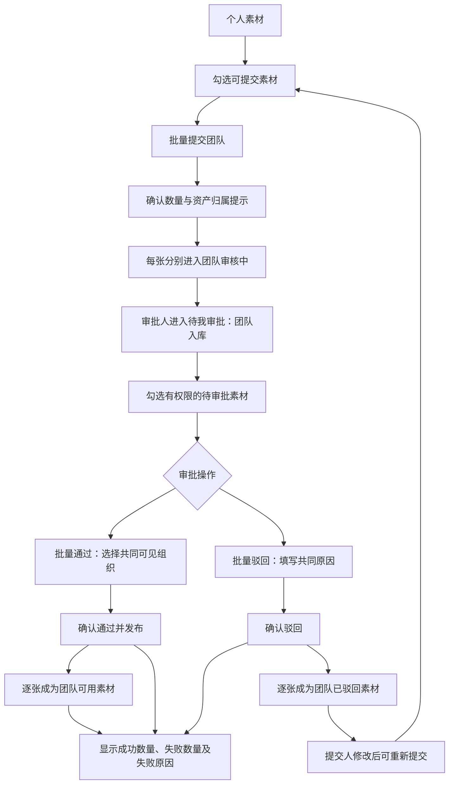

# 先马 AI 设计平台｜素材库批量提交与审批 PRD

## 1. 文档信息

| 项目 | 内容 |
|---|---|
| 所属模块 | 素材库 |
| 需求类型 | 现有流程效率优化 |
| 文档版本 | V1.0 |
| 文档日期 | 2026-10-14 |
| 需求状态 | 本期产品范围及核心规则已确认，可作为开发需求依据 |
| 原型状态 | 已制作并完成本地交互验证，待用户验收 |
| 落地状态 | 本次批量能力待真实业务落地与上线验收；原型验证不代表生产可用 |
| 需求来源 | 运营反馈提交团队及审批需逐张操作；产品负责人确认只支持批量提交、批量审批，以最简单方式实现 |
| 关联规则 | 《素材库、提示词库与权限管理 PRD》V1.12中的素材库现行规则 |
| 原型参考 | 素材库“个人素材”及“待我审批—团队入库”页面；以本文业务规则为准 |

### 修订记录

| 版本 | 日期 | 内容 |
|---|---|---|
| V1.0 | 2026-10-14 | 明确批量提交团队、批量通过、批量驳回的流程、权限、异常及验收标准 |

## 2. 背景与目标

运营需要将较多素材提交为团队资产，目前提交和审批均需逐张操作，产生重复点击、反复确认及逐项设置的时间成本。

本期目标：允许用户一次选择多张独立素材并提交团队，允许审批人一次通过或驳回多张素材，减少重复操作，缩短素材进入团队可用库的时间。

每张素材保持独立，不新增“套图”或整批资产，不改变现有个人、团队、公共素材的资产体系。

效率基线、实际批量规模及改善目标尚无已确认数据，不预设节省比例；上线后结合运营实际使用复盘。

## 3. 本期范围

| 功能 | 本期变化 | 用户结果 |
|---|---|---|
| 素材选择 | 单张勾选、当前页全选、清空选择、已选数量 | 一次选出本次要处理的素材 |
| 批量提交团队 | 个人素材中选择多张可提交素材，一次确认 | 所选素材分别进入所属部门的团队入库审批 |
| 批量通过 | 团队待审批素材中多选，一次设置共同可见组织 | 所选素材分别成为团队资产，使用相同可见范围 |
| 批量驳回 | 团队待审批素材中多选，一次填写共同原因 | 所选素材分别被驳回，提交人能查看原因并修改 |
| 处理反馈 | 显示成功与失败数量及失败项原因 | 用户明确哪些素材处理成功，哪些需要再次处理 |

### 本次不做

- 套图、整批资产、批次管理或新审批层级。
- 跨页全选、全部搜索结果全选。
- 批量取消提交、批量撤回审批、批量编辑、批量删除或批量分组。
- 上传流程改造、图片命名改造。
- 团队到公共的批量申请或批量审批。
- 提示词库、商品库及其他模块的批量操作。
- 新的审批角色、组织授权方式或审批制度。

图片、视频、音频沿用素材库现有支持范围，不因本期新增或缩减类型。现有单张操作继续保留。

## 4. 用户与权限

| 用户 | 可执行操作 | 限制 |
|---|---|---|
| 素材提交人 | 批量提交本人个人素材 | 仅可用或团队已驳回的素材；团队审核中、已发布及他人素材不可提交 |
| 审批员 | 批量通过、批量驳回团队入库申请 | 同时具备素材入库审批权限，且提交人所属组织命中其授权范围 |
| 部门管理员 | 批量审批管理组织范围内的团队入库申请 | 可见组织不得超出其授权组织范围 |
| 系统管理员 | 批量审批团队入库申请 | 可设置全公司范围内的组织 |

沿用现行权限规则：

1. 满足角色、审批事项和组织范围的审批人可以审批本人提交的素材，不新增禁止自审限制。
2. 不因“批量”获得原来没有的提交或审批权限。
3. 不同提交人或不同部门的待审批素材可以一起选择，但每张均须满足审批人的权限条件。
4. 批量通过统一使用一组可见组织；需要不同可见范围的素材应分批处理。
5. 团队审批通过后，素材成为团队资产，发布人不能自行删除；沿用现有团队管理规则。

## 5. 用户流程

### 5.1 批量提交团队

1. 提交人进入“个人素材”。
2. 勾选多张可提交素材，或使用“当前页全选”。
3. 点击“批量提交团队”。
4. 确认窗口显示数量、素材名称、提交部门和审批后的资产归属提示。
5. 用户确认提交；不新增统一推荐说明填写步骤，保留每张素材的原备注。
6. 每张素材分别进入团队入库审批，所属部门按提交人当前组织信息沿用现行规则确定。
7. 显示处理结果，更新素材状态及待审批数量，清空本次选择。

取消确认或关闭确认窗口，不提交、不改变素材状态，保留当前选择。

### 5.2 批量通过

1. 审批人进入“待我审批”的“团队入库”列表。
2. 勾选有权限的待审批素材。
3. 点击“批量通过”，查看所选数量与素材清单。
4. 选择至少一个共同可见组织；初始不自动采用某张素材的所属部门，需审批人明确选择。
5. 点击“确认通过并发布”。
6. 每张素材分别通过团队审批，对选中组织及其下级可见。
7. 显示处理结果，成功项从待审批中移除，更新团队素材和待审批数量，清空本次选择。

### 5.3 批量驳回

1. 审批人进入团队入库待审批列表并勾选素材。
2. 点击“批量驳回”，查看数量与清单。
3. 填写一个共同驳回原因；不同原因的素材分批处理。
4. 点击“确认驳回”。
5. 每张素材分别记录同一原因并成为“团队已驳回”，继续保留在提交人的个人素材中。
6. 显示处理结果，成功项从待审批中移除，清空本次选择；提交人可查看原因、修改并重新提交。

## 6. 页面与交互要求

### 6.1 素材选择

- 个人素材中，仅可提交素材显示勾选入口；团队入库待审批中，仅有审批权限且仍待审批的素材显示勾选入口。
- 勾选与查看素材互不干扰；勾选不自动打开预览，不改变素材内容。
- 当前页全选只选中当前页符合条件的素材，不包含其他页或不符合条件的素材。
- 支持取消单张勾选、取消全选和清空选择。
- 当前页部分符合条件的素材被选择时，全选控件呈部分选中状态。
- 显示“已选 X 个”。未选择时，批量操作及清空选择按钮禁用。
- 切换个人/团队/公共页签、团队/公共审批类型、搜索条件、任何筛选条件、页码或每页数量时，清空选择。
- 完成批量处理后清空选择；取消确认保留选择。

### 6.2 操作入口及确认窗口

| 场景 | 入口/内容 | 确认条件 |
|---|---|---|
| 个人素材 | 批量提交团队 | 已选至少一张可提交素材 |
| 团队入库待审批 | 批量通过、批量驳回 | 已选至少一张可审批素材 |
| 提交确认 | 数量、素材名称、提交部门、资产归属提示 | 无新增必填说明 |
| 通过确认 | 数量、素材清单、共同可见组织 | 至少一个可见组织，且在审批人授权范围内 |
| 驳回确认 | 数量、素材清单、统一驳回原因 | 去掉前后空格后的原因非空 |
| 处理结果 | 成功数量、失败数量、失败素材及原因 | 用户可关闭并返回当前列表 |

团体素材普通列表、公共素材及公共发布审批不增加本期批量操作入口。

### 6.3 关键文案

| 场景 | 文案 |
|---|---|
| 全选 | 当前页全选 |
| 提交按钮 | 批量提交团队 |
| 审批按钮 | 批量通过 / 批量驳回 |
| 提交归属提示 | 审批通过后，该素材将成为团队资产，发布人将无法自行删除。如需删除，请联系团队负责人处理。 |
| 通过范围提示 | 以下可见组织统一用于所有选中素材。需要不同范围的素材请分批审批。 |
| 驳回原因提示 | 所有选中素材使用同一原因；原因不同请分批驳回。 |
| 处理反馈 | 提交/通过/驳回成功 X 个，失败 Y 个。 |

### 6.4 使用状态与布局

- 处理期间显示正在提交/正在审批，禁止重复确认，避免用户误以为未响应而反复点击。
- 处理前关闭确认窗口不产生操作；处理开始后的关闭或离开页面不视为撤回，不增加“整批取消”功能。
- 重新进入页面后展示真实最新状态；不得把仍在处理或结果未知的素材展示为已成功。
- 没有符合条件的素材时，显示现有空态，不允许发起空批次。
- 批量操作栏在窄屏可换行；确认窗口不被侧栏或列表裁切，不横向溢出。
- 桌面、1280px、1024px及窄屏均可完整使用；空间不足时滚动内容，标题、关闭及操作区保持可见。
- 支持取消、关闭、Escape关闭；键盘可以选择素材并操作弹窗，弹窗打开后焦点留在弹窗内。

## 7. 业务规则与状态

### 7.1 独立素材、独立审批

批量仅减少操作次数，每张素材仍独立提交、独立审批、独立记录处理结果，不生成新的套图、内容副本或整批资产。沿用同一素材在个人、团队及公共范围的现有展示和引用规则。

| 操作 | 操作前 | 成功后 | 其他要求 |
|---|---|---|---|
| 批量提交团队 | 本人个人素材，可用或团队已驳回 | 团队审核中 | 保留原备注，重新提交后旧驳回原因不再作为当前驳回结果 |
| 批量通过 | 团队审核中且有审批权限 | 团队已发布/团队可用 | 对共同选中的组织及其下级可见，沿用现有来源记录 |
| 批量驳回 | 团队审核中且有审批权限 | 团队已驳回 | 保留个人素材及原备注，记录共同驳回原因 |
| 任一操作失败 | 未满足该操作条件 | 不因本次失败而改变其实际状态 | 按最新事实展示并说明原因 |

团队审核中沿用现有单张规则：不能编辑、删除或重复提交，可使用原有单张取消提交。批量通过后的共享与删除权限沿用现有规则。

### 7.2 部分成功与重复操作

1. 操作执行时，每张素材重新判断是否仍满足状态和权限条件。
2. 某张失败，不撤销同批其他已成功素材。
3. 处理结果必须区分成功和失败，并明确每个失败项原因，不能只给“批量操作失败”。
4. 已被审批、已取消提交、已删除或权限变化的素材，不继续按旧页面信息处理。
5. 同一素材重复选择或重复点击，不生成重复申请或重复审批结果。
6. 多人同时审批同一申请，只有首次有效处理生效，其他人看到“该申请已被审批”及实际最新状态。
7. 已驳回素材允许重新提交，之后的新申请沿用现有审批规则，不能与上次申请的处理结果混淆。

## 8. 异常情况

| 情况 | 用户可观察结果 | 后续处理 |
|---|---|---|
| 未选择素材 | 批量按钮禁用 | 选择素材后可操作 |
| 通过时未选可见组织 | 确认按钮禁用 | 选择后确认 |
| 驳回原因为空或仅空格 | 确认按钮禁用 | 填写有效原因 |
| 素材已被其他审批人处理 | 该项失败，提示已被审批 | 更新列表，不覆盖已有结论 |
| 提交人已取消提交 | 该项不再可审批 | 更新列表，其余有效项继续处理 |
| 素材已不存在 | 该项失败，提示素材已不存在 | 不影响其他成功项 |
| 无权限或可见组织超出授权 | 不执行越权操作，提示原因 | 重新选择符合权限的素材或组织 |
| 部分项失败 | 显示成功/失败数量和失败项原因 | 成功项保留，未成功且仍符合条件的项可重新选择处理 |
| 请求失败或结果无法确认 | 明确提示失败或结果待确认，不显示虚假成功 | 核对最新状态后处理，避免重复申请或审批 |
| 刷新、离开或重新进入页面 | 显示实际已保存的最新状态 | 不自动撤回或恢复已处理申请，不保留跨页选择 |

格式、大小、素材类型、备注长度、驳回原因长度、分页及数量限制沿用当前有效规则；本期不新增新的业务限额。不能因为一次选择较多而静默漏处理部分素材。

## 9. 验收标准

| 编号 | 前置条件与操作 | 可观察结果 | 对应章节 |
|---|---|---|---|
| 验收01 | 本人个人库混有可用、已驳回、审核中素材，点击当前页全选 | 只选中当前页可用及已驳回项；审核中不被勾选；数量准确 | 4、6.1 |
| 验收02 | 同页部分素材已选，取消单张、取消全选、清空选择 | 勾选和数量同步；部分选中提示正确；无选择时批量按钮禁用 | 6.1 |
| 验收03 | 已选素材，分别切换页签、审批类型、搜索、筛选、页码、每页数量 | 每次切换均清空选择，无跨页隐藏选择 | 6.1 |
| 验收04 | 选择多张个人素材，批量提交并确认 | 每张分别成为团队审核中；原名称、内容和备注保留；提交到本人所属部门 | 5.1、7.1 |
| 验收05 | 已驳回的本人素材重新批量提交 | 进入新的待审批状态，旧驳回原因不作为当前审批结果 | 7.1、7.2 |
| 验收06 | 打开任一批量确认窗口后取消、关闭或按Escape | 不产生提交或审批，素材状态未改变，当前选择保留 | 5、6.4 |
| 验收07 | 选择多张待审素材，不选可见组织 | 不能确认通过；选择授权组织后才能确认 | 5.2、6.2 |
| 验收08 | 多张待审素材选择同一组组织，批量通过 | 每张均成为团队可用，对该组组织及下级可见；待办移除；不复制内容 | 4、5.2、7.1 |
| 验收09 | 同一审批人选择不同提交人或部门的待审素材 | 只有有权限的素材可处理，全部通过项使用明确选定的共同可见范围 | 4 |
| 验收10 | 批量驳回原因为空或仅空格；随后填写有效原因 | 空原因不能确认；有效原因逐张保存，素材保留个人库，可修改重提 | 5.3、6.2 |
| 验收11 | 所选中有一项已处理、一项已取消、一项已删除，另有有效项 | 过期项不被处理，逐项说明原因；有效项成功且不回滚 | 7.2、8 |
| 验收12 | 普通用户、范围内审批人、范围外审批人、部门管理员、系统管理员分别操作 | 权限按现有角色及组织范围生效，不能因批量越权；系统管理员可按现有规则审批 | 4、8 |
| 验收13 | 审批人具备对应权限，审批本人提交的素材 | 可以审批，不出现本期新增的禁止自审规则 | 4 |
| 验收14 | 选择超出授权的可见组织或操作时权限已变化 | 不发布到越权范围，不形成越权审批结果，提示原因 | 4、8 |
| 验收15 | 连续确认或多人同时审批同一申请 | 不生成重复申请/结果；首次有效处理生效，其余提示最新状态 | 7.2 |
| 验收16 | 部分失败后重新处理仍符合条件的失败项 | 已成功项不重复生效，未成功项可独立完成 | 7.2、8 |
| 验收17 | 请求失败、结果未知或处理过程中离开页面，再进入 | 不显示虚假成功，不自动撤回；页面展示实际最新状态，可安全判断后续操作 | 6.4、8 |
| 验收18 | 完成提交、通过、驳回后关闭结果窗口 | 成功/失败数量准确，失败原因完整，列表及数量更新，选择清空 | 5、6.2 |
| 验收19 | 使用原单张提交、取消提交、审批，以及公共发布审批 | 原流程可用；公共审批无本期批量入口；上传、命名、个人分组不受本期改动影响 | 3、7.1 |
| 验收20 | 团队通过后由提交人查看来源记录、尝试删除，由命中范围用户查看素材 | 沿用现有同素材来源记录与团队视图；发布人不能自行删除；可见用户按组织使用 | 4、7.1 |
| 验收21 | 在桌面、1280px、1024px及窄屏操作三个批量窗口 | 无裁切、横向溢出或按钮遮挡；短屏内容可滚动，头尾可见，键盘可操作 | 6.4 |
| 验收22 | 图片、视频、音频的可提交及待审批素材参与批量操作 | 支持当前素材库已有类型，仍保持每张/每个素材独立处理 | 3 |

以上验收需在实际业务环境使用真实账号和保存后的素材状态验证；原型中的成功提示不能代替真实落地验收。

## 10. 历史兼容、效果与上线边界

### 10.1 历史兼容

- 既有个人素材、待审批申请、已驳回素材均按现有条件参与本期操作，不要求重新上传。
- 已发布素材不重复进入团队入库流程，不改写原共享范围或历史审批记录。
- 不因本期变更改变素材的名称、类目、标签、备注、个人分组、内容或来源关联。
- 本期不改变AI生成、图片命名、积分、下载、历史记录及公共发布制度。

### 10.2 效果评价

重点观察运营一次提交多张素材的操作耗时、审批人一次处理多张素材的操作耗时、素材提交至团队可用的周期，以及批量成功/部分失败情况。统计只以实际提交和审批结果为准，不能把点击按钮计为处理成功。

当前无已确认基线和目标值，上线后采集实际样本并与原单张流程比较；本期不新增数据看板或独立统计模块。

### 10.3 上线条件与回退

- 本期规则及验收01～22在实际业务环境通过，既有单张流程无回归问题。
- 刷新或换页面后结果仍准确，真实权限生效，多人同时审批不产生冲突结论。
- 原型已制作和本地交互已验证不等于真实能力已开发、验收、部署或上线。
- 如上线后停用批量入口，保留原单张流程；已完成的有效提交及审批结果仍按现有规则保留，不整批回滚或删除素材。

本文件仅为产品需求，具体技术实现由研发依据现有系统确定；不新增套图或其他本期排除能力。
