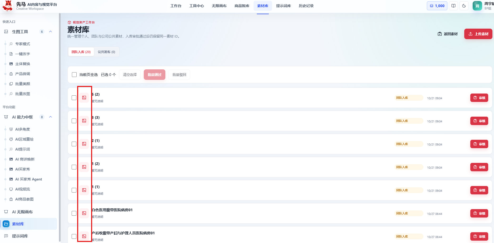

# 先马 AI 设计平台｜背景色快捷选择、任务完成提醒与素材审批缩略图 PRD

## 0. 文档信息

| 项目 | 内容 |
|---|---|
| 版本 / 日期 | V1.0 / 2026-10-27 |
| 本期范围 | 背景色快捷选择；平台图片、视频输出任务完成提醒；批量审批素材展示缩略图 |
| 产品规则 | 已确认；提醒范围覆盖全部图片、视频输出任务，包括无限画布、视频流及工作流 |
| 原型状态 | 背景色控件已在四个页面展示；任务提醒仅个人菜单开关与开启时的右下角模拟提醒 |
| 生产状态 | 本次未接入账号颜色存储、系统通知授权、真实任务事件或生产结果定位；未生产验收、部署或上线 |
| 需求来源 | 运营需求、已确认产品规则及交互参考（2026-10-27）；未编制REQ编号 |
| 对应原型 | 2026-10-27本仓库原型；`/image-tools/expert`、`/image-tools/batch-edit`、`/image-tools/subject-replace`、`/ai-hub/detail-refresh`及全局个人菜单 |
| 正式源 / 开发副本 | 本知识库Markdown为正式产品源；仓库`docs/背景色快捷选择与任务完成提醒PRD_261027.md`为一致的开发基线 |

### 变更摘要

#### 1. 背景色快捷选择｜新增

在现有提示词区选颜色、插入一句可编辑指令，减少反复上传纯色色卡和手写背景换色要求。

1. **公共颜色库**：常规渐变色板、标准色、个人颜色；支持吸色、上传素材取色、命名保存及删除。
2. **专家模式**：空白或已有提示词均使用同一句背景色指令。
3. **批量改图**：多张商品图共用同一目标色，原背景允许不同。
4. **主体替换**：沿用主体替换要求，同时指定背景底色。
5. **商详焕新**：整组背景色统一，保留或替换商品仍按原规则处理。

#### 2. 全平台任务完成提醒｜新增

用户停留首页、其他模块、其他浏览器标签或软件时，仍能获知自己的图片、视频任务结束，并访问对应结果。

1. **统一开关与授权**：右上角个人菜单增加“任务完成提醒”，按当前账号、当前浏览器记忆。
2. **全入口覆盖**：生图工具、AI能力中心、无限画布图片/视频节点、工作流输出、AI视频流及其他实际产出图片/视频的任务统一接入。
3. **状态与去重**：整项任务终态提醒一次，区分成功、部分成功、失败；批量不逐张提醒。
4. **任务访问**：通知携带稳定任务身份；点击回到具体任务结果，画布定位到项目内对应任务/节点；支持登录恢复与权限校验。
5. **展示边界**：不主动配置自动消失；允许手动关闭，但不承诺操作系统永久保留通知。原型只模拟右下角UI，不连接真实任务。

#### 3. 批量审批素材缩略图｜优化

1. **列表直接看图**：素材库“团队入库”批量审批列表直接展示每条上传图片的真实缩略图，替换截图红框内的通用图片图标，方便审批人判断是否通过。
2. **沿用审批流程**：不改变选择、当前页全选、批量通过/驳回、单项审核及权限规则；沿用现有原型；本期补充审批列表缩略图展示要求及参考图。

### 修订记录

| 版本 | 日期 | 内容 |
|---|---|---|
| V1.0 | 2026-10-27 | 首次正式交付：背景色快捷选择、全平台图片及视频输出任务完成提醒、批量审批素材缩略图；明确业务规则、交互边界与验收标准 |

## 1. 背景、目标与范围

### 1.1 目标与现状

- 背景色现有业务操作：原图与纯色色卡一并上传，再手写“将图片1背景替换为图片2颜色”；本期通过颜色资产和快捷句减少重复操作。
- 任务提醒现有问题：生成期间离开工作页后需要主动返回查看。本期按任务实际终态主动提醒，而非依赖某页面的局部提示。
- 基线依据：用户提供的专家模式操作截图、桌面完成通知截图、右上角个人菜单位置截图；截图仅为需求证据，不将第三方软件规则或账号信息复制为平台规则。
- 可衡量结果：颜色复用率、背景色插入使用量、任务结束至打开结果的耗时、提醒点击率。当前无核实的数量基线或改善目标，发布后采集，运营复盘，目标值待上线后根据实际数据确定。

### 1.2 范围矩阵

| 模块 | 本期动作 | 原型证据 | 生产接入 |
|---|---|---|---|
| 公共颜色控件（CLR） | 选择、添加、删除、个人保存 | `ColorConstraintPicker.jsx`、`background-colors.js` | 账号个人颜色存储待开发 |
| 专家模式（EXP） | 提示词区接入颜色控件 | `/image-tools/expert` | 沿用生成链路 |
| 批量改图（BAT） | 统一背景色指令 | `/image-tools/batch-edit` | 沿用逐图任务链路 |
| 主体替换（SR） | 替换与背景色要求并用 | `/image-tools/subject-replace` | 沿用替换链路 |
| 商详焕新（DR） | 整组背景色指令 | `/ai-hub/detail-refresh` | 沿用组图链路 |
| 素材审批缩略图（MAT） | 将团队入库审批列表通用图标替换为真实图片缩略图 | 用户2026-10-27标注截图，见需求三内嵌图 | 开发落地优化，原型不改 |
| 统一任务提醒（NT） | 个人菜单、通知与结果访问 | `Topbar.jsx`、`task-reminders.js`仅模拟 | 授权、全局任务订阅、去重和定位待开发 |
| 全部图片/视频入口 | 任务终态接入NT，见第3章 | 部分页面原型占位 | 不以原型是否可生成为生产接入豁免条件 |

### 1.3 本次不做

- 不新增颜色库管理页面或独立换背景工具；不新增蒙版识别、圈选确认、调色算法。
- 不新增团队共享颜色、审批、颜色分组、批量管理、透明背景/无填充入口。
- 不改变现有模型、积分扣费、商品事实、生成数量和输出规格规则。
- 不做所有平台页面关闭后的离线推送、邮件/钉钉通知；网站关闭后再次打开不弹历史任务完成通知。
- 不为纯提示词、纯文字、音频、普通上传/下载、素材审批发送本期图片/视频完成提醒；涉及真实图片/视频生成输出时纳入。
- 原型不实现真实通知授权或任务事件；该限制不能写成正式产品仅覆盖模拟任务。

## 2. 需求一：背景色快捷选择

### 需求目标与闭环

减少反复上传纯色色卡和编写换背景指令的操作。完整流程为：打开现有页面颜色控件 → 选常规色或添加个人颜色 → 插入本页面固定提示词 → 自由编辑 → 沿用原任务提交与结果查看。颜色选择、保存删除、四页面应用、AI边界、数据与验收全部归属本章；四页面是同一需求的使用场景，不独立拆为主章。

本章覆盖公共控件CLR及专家EXP、批量改图BAT、主体替换SR、商详焕新DR的接入编号。

### 2.1 用户流程与入口

四个已确认页面的提示词工具栏均增加“更改背景色”，打开同一颜色面板。选择颜色后点击“插入提示词”，返回编辑框继续编辑，提交仍取最终编辑框文本。未选色不改变原流程。

### 2.2 已确认业务规则

| 编号 | 规则 |
|---|---|
| CLR-CHG01 / CLR-R01 | 颜色面板包含常规颜色、标准色、我的颜色；常规颜色为10个色系，每列6级由浅到深；标准色14个。色块选中显示勾选，下方显示名称和HEX，悬停显示名称/色值；窄屏不溢出，弹窗正文可滚动，标题和操作区保持可见。 |
| CLR-CHG02 / CLR-R02 | 常规/标准色只读。初始选白色，选色不立即改提示词；关闭面板或未点击插入，不改变原文字。颜色定义取本期`background-colors.js`，色值是素材数据，不是UI主题令牌。 |
| CLR-CHG03 / CLR-R03 | “添加颜色”只提供吸色、上传颜色素材及自定义名称；不新增HEX/RGB手工输入功能。上传素材后点击像素取色，再命名保存，不自动抽取整张图的多个颜色，也不将色卡自动加入生图参考队列。 |
| CLR-R04 | 吸色取消不报错、不保存；浏览器不支持屏幕吸色时提示上传素材后点击取色。上传格式PNG/JPG/WebP，最大10MB（当前原型约束）；透明像素不作为确定颜色，提示选不透明区域。格式错误、超限或读取失败需提示并允许重试。 |
| CLR-R05 | 保存名称去首尾空格，必填，最长30字（当前原型约束）；色值规范化为大写`#RRGGBB`。颜色库按账号保存，四页面复用，换设备登录读取同一账号个人颜色；当前浏览器localStorage仅是演示，不是正式持久化。 |
| CLR-R06 | 同一账号内相同HEX保存时更新名称，不新增重复色；同名不同HEX允许保存；不同账号互不读取。保存失败保留表单和原记录，显示失败，不假报保存成功。 |
| CLR-R07 | 自定义颜色标签右上角小“×”删除，常规/标准色无删除；删除仅移除个人库记录，不改已选色值、已插入提示词和历史任务。保存删除成功后四个入口读取同一最新结果。 |
| CLR-R08 | 保存成功后收起新增区并清除上传素材；再次添加时名称、素材、读取状态重置，旧文件的异步回调不得回填新表单。保存失败不清表单。 |
| CLR-CHG04 / CLR-R09 | 插入指令追加在当前提示词末尾。再次选色时，当前编辑会话中上一句自动插入文本仍完整存在则替换该句，保留其他文字；被用户改写或删除后不猜测覆盖，追加新句供用户编辑。刷新/恢复历史后不根据文意推断旧句来源。 |
| CLR-R10 | 插入后文本可自由编辑、删除；提交、AI润色、模板回填等仍沿用现有规则，不隐藏追加额外颜色参数。超过页面既有字数上限时阻止本次插入并提示，保留原文和面板供调整，不截断。 |

### 2.3 标准色清单

| 名称 | HEX | 名称 | HEX |
|---|---|---|---|
| 白色 | #FFFFFF | 浅灰 | #F2F2F2 |
| 深灰 | #555555 | 黑色 | #000000 |
| 米白 | #F5F0E6 | 红色 | #D9353F |
| 橙色 | #F28C28 | 黄色 | #F5D547 |
| 绿色 | #39845A | 浅蓝 | #DCEBFA |
| 蓝色 | #20358A | 紫色 | #8064A2 |
| 粉色 | #F4CCD6 | 棕色 | #8B6148 |

常规色系为灰、米、蓝灰、蓝、橙、黄、绿、青、红、紫，具体60个HEX以本期原型数据文件为交付附件；标准色及各色系可有相同HEX，不增加重复个人记录。

### 2.4 新增数据语义

以下为业务字段建议命名，接口/数据库命名由技术确认；无事实依据的ID长度沿用现有平台规则，不编造数值。

| 对象/字段 | 类型/必填 | 校验及默认 | 来源/责任 |
|---|---|---|---|
| 个人颜色`id` | 标识/必填 | 唯一，格式沿用平台 | 服务端 |
| `ownerUserId` | 账号标识/必填 | 当前登录账号，只读；禁止客户端指定其他所有者 | 登录态 |
| `name` | 文本/必填 | 去首尾空格，1～30字 | 用户输入 |
| `hex` | 字符串/必填 | 大写`#RRGGBB`，7字符；账号内按HEX去重 | 取色结果 |
| `createdAt/updatedAt` | 时间/必填 | 平台时间格式，客户端只读 | 服务端 |
| 提交提示词 | 沿用现有任务字段 | 提交时保存最终编辑框文本快照；后续改名/删除不回写旧任务 | 原任务服务 |

来源色卡只用于取色，不作为本期颜色记录必存字段；不默认长期保存上传原图，具体临时处理沿用平台上传治理。

### 2.5 验收

| 编号 | 规则 | 操作 | 预期 |
|---|---|---|---|
| CLR-AC01 | R01～02 | 四页面打开颜色面板，分别在桌面、1280、1024和窄屏检查 | 同一色板、选中反馈与名称HEX正确；弹窗不被侧栏裁剪；可关闭，键盘可操作 |
| CLR-AC02 | R03～04 | 吸色、取消吸色、不支持浏览器；上传色卡点取不透明/透明区 | 取色正确；取消不入库；不支持时有替代入口；透明区提示重选 |
| CLR-AC03 | R04～06 | 上传错误格式/超限图片；空名称；同色改名；同名不同色 | 错误可重试；名称校验；同HEX更新、同名异色并存 |
| CLR-AC04 | R05～07 | 账号A新增后跨四页面、换设备查看；账号B查看；删除颜色 | A同步、B不可见；仅个人色可删；原提示词、历史快照不变 |
| CLR-AC05 | R08 | 上传、命名、保存，再次添加；模拟慢读取回调 | 新表单无旧素材/名称，旧回调不污染；保存失败保留内容 |
| CLR-AC06 | R09～10 | 空白插入、原文追加、重复换色、手改后再选、字数临界 | 更新完整自动句；不覆盖手改文字；超限不截断、不丢原文 |

### 2.6 使用场景一：专家模式（EXP）

- **EXP-CHG01 / EXP-R01**：在“专家级创作指令”工具栏接入CLR。无论原文是否为空，固定插入：
  > 将背景底色更改为{颜色名称}（{色值}），保持商品、文字、Logo、图标及排版不变。
- 不做空/有指令分支判断；用户有其他编辑要求时自行修改冲突文字。允许修改背景的含义为设计底色，不隐含产品自身换色。商品结构、Logo、文字、排版等为保留要求，不承诺逐像素绝对不变。
- 输入、模型、0～14张参考图等沿用现有规则；仅颜色选择不额外加入色卡参考图。
- **EXP-AC01（R01）**：清空提示词后选蓝色插入；再在有文字时选其他颜色；固定模板可独立成立、原文保留且可编辑。
- 证据：`ExpertWorkbench.jsx`、`background-color-prompt.mjs`，当前原型，真实模型效果未验收。

### 2.7 使用场景二：批量改图（BAT）

- **BAT-CHG01 / BAT-R01**：在“统一修改提示词”工具栏接入CLR，固定插入：
  > 将每张图片的背景底色统一更改为{颜色名称}（{色值}），保留商品、文字、Logo、图标及排版不变。
- 同批原图可为不同底色；同次任务所有图片使用提交文本快照，不因随后改颜色库而变更在跑任务。不新增一图多色输出功能。
- **BAT-AC01（R01）**：混合红/白/黄背景图选同一蓝色，核对每张任务输入为同一目标色；生成质量人工检查，不允许把商品同色区域全局替换。
- 证据：`BatchEditWorkbench.jsx`，生成数量、失败重试、计费沿用原批量规则。

### 2.8 使用场景三：主体替换（SR）

- **SR-CHG01 / SR-R01**：在“替换指令”工具栏接入CLR，固定插入：
  > 按原有要求完成主体替换，同时将背景底色更改为{颜色名称}（{色值}）。
- 颜色要求不能覆盖主体替换来源与商品事实规则；不追加“商品不变”而阻断本次主体替换。没有可执行替换要求时沿用原页面校验，选色不替代主体输入条件。
- **SR-AC01（R01）**：配置主体替换并选背景色，提交包含两类要求；无选色时原替换流程不变。
- 证据：`SubjectReplaceWorkbench.jsx`；商品智库优先级、分别生成等沿用原已确认规则。

### 2.9 使用场景四：商详焕新（DR）

- **DR-CHG01 / DR-R01**：“补充提示词”区接入CLR，固定插入：
  > 将整组详情图的背景底色统一更改为{颜色名称}（{色值}），商品按原有保留或替换要求处理，不新增未提供的商品事实。
- 未选商品替换来源保持原商品，已选来源按原替换规则；背景色要求不锁死原版式从而阻断焕新。补充提示词500字上限沿用当前页面。
- **DR-AC01（R01）**：分别在无替换来源和有替换来源时插入，商品规则不冲突；超500字提示精简，不截断原内容。
- 证据：`DetailRefreshPage.jsx`；正式规则参考已有《AI商详焕新MVP1.0需求PRD_260911.md》，本次只增量接入。

### 2.10 四个页面共用的颜色AI契约

| 契约 | 要求 |
|---|---|
| 输入/事实来源 | 原任务输入和商品事实沿用；新增的是最终提示词中的颜色名称与HEX，不新增模型接口或强制参考图 |
| 优先级 | 颜色库只帮助填写。提交后以编辑框最终文本为准；不得将用户删掉的色值从隐藏状态重新加入请求。原模块商品事实与合规规则继续生效 |
| 业务Prompt | 第2.6～2.9节四种固定模板；允许目标背景改色；不能把同色商品/文字当背景一起改；原背景可不同 |
| 模型适配 | 四页面继续使用各自既有模型与输入规格；模型对HEX理解和保留能力由开发实测并记录，不新指定供应商、不据提示词承诺准确还原 |
| 输出/成功 | 沿用原任务对象、顺序和规格；技术生成成功不等于背景色质量验收通过。用户检查色彩一致性、商品真实性及保留项 |
| 失败/人工接管 | 沿用原任务失败、单图重试和人工改词流程；不新增自动无限重试、自动补偿或自动发布 |
| 计费 | 打开/选色/存删/插入不调用生成模型；正式提交和重试沿用原页面计费。提醒不额外生成内容或扣积分 |
| 兼容矩阵 | EXP单次生成、BAT多图、SR多源替换、DR组图均取最终文本；原历史任务无颜色库引用也可继续查看，不做推断迁移 |

### 2.11 责任边界、原型状态与效果指标

- 前端：复用公共颜色控件与提示词编辑器，四页面按本章模板插入可编辑文字，处理新增重置、删除和超限反馈。
- 个人颜色服务：按账号持久化、校验所有权、同HEX更新，四入口消费同一数据；当前原型本地存储不替代正式账号存储。
- 原任务及模型：沿用提交文本快照和模块任务协议，按2.10适配与质检；不增加隐藏颜色参数或独立生成链路。
- 当前原型：公共控件、四页面接入、删除和表单重置已展示；账号跨设备存储、真实模型色值和保留质量待开发联调，不标已上线。
- 指标：颜色选择/插入、个人色保存/删除、颜色复用率及用户换色质量反馈；现有量化基线未核实，上线后采集复盘。
- 验收入口：公共交互按CLR-AC01～06，各使用场景分别按EXP/BAT/SR/DR-AC01；共同AI契约按2.10检查真实输出，文本测试不代替视觉验收。

## 3. 需求二：全平台任务完成提醒（NT）

### 需求目标与闭环

让用户离开生成页面后仍能获知自己的媒体任务结束，并访问对应结果。完整流程为：个人菜单开启并授权 → 全局订阅自己的图片/视频任务 → 根据当前查看任务与执行身份判断提醒/去重 → 显示真实终态通知 → 点击访问具体任务结果 → 处理登录、权限和结果失效。全部覆盖范围、交互、业务规则、任务字段、异常与验收均归属本章。

### 3.1 已确认范围与接入清单

**范围以真实输出类型为准，而不是仅按页面名称或当前原型是否完整。所有图片输出任务，以及视频流、无限画布等所有视频输出任务均纳入。** 未来已有入口新增图片/视频任务分支时，同样遵守本公共规则，不得因未写在静态名单而漏接。

| 业务入口 | 需提醒的任务 | 点击后的业务目标 |
|---|---|---|
| 专家模式 | 文生图、参考图编辑任务 | 对应专家任务的结果集 |
| 一键改字 | 实际提交生成输出图片的任务 | 对应改字任务结果；纯本地文字编辑/导出不视为异步生成 |
| 主体替换 | 合并/分别等现有替换生成任务 | 对应任务及结果集，按既有父子任务关系归并 |
| 产品微调 | 图片精修生成 | 对应微调任务结果 |
| 批量美颜、批量改图 | 整批生成及用户发起的重试执行 | 对应批次，展示成功与失败明细 |
| AI多角度、AI区域重绘 | 多角度组图、区域生成 | 对应任务结果；多角度不逐角度弹出 |
| AI买家秀、买家秀Agent | 图片生成、用户发起的图片再生成 | 对应任务图片结果；不以文字评价生成为图片提醒触发 |
| AI商详焕新、AI商品套图 | 整组详情/套图及重试执行 | 对应组图任务结果 |
| AI视频流 | 文生视频、图生视频、多参考视频等已有视频生成分支 | 对应视频任务结果，可查看/播放 |
| 无限画布 | 图片节点、视频节点、角色四视图、现有生成工作流中的图片/视频输出 | 指定画布项目、执行任务及输出节点/结果组；不能只到画布项目列表 |
| 封装工作流/模板运行 | 执行后实际产出图片或视频的任务 | 对应工作流执行详情及输出；不能只到模板表单 |
| 商品智库及其他现有入口 | 实际触发图片/视频生成的还原、再生成等任务 | 对应对象下的本次任务输出；仅学习文字信息不发本提醒 |
| AI提示词等文字入口 | 纯文字无图片/视频输出 | 不提醒；若其某分支确实生成媒体则按媒体任务接入 |

当前本地AI视频流、区域重绘等为占位页面，只能说明原型未演示，不代表正式系统不存在，不因占位排除上线接入验收。

### 3.2 开关与授权（NT-CHG01）

**NT-R01**：右上角个人菜单“刷新账号信息”下、“退出登录”上设置“任务完成提醒”。初始未开启。开关是当前账号在当前浏览器上的偏好；同浏览器重新打开保留，切换账号隔离，换设备/新浏览器重新授权。浏览器权限本身属于网站权限，不伪装为账号级授权。

| 状态（标识为建议命名，待技术映射） | 展示 | 点击及结果 |
|---|---|---|
| 未开启`OFF` | 未开启、开关关闭 | 用户主动点击申请通知权限；已授权则直接打开偏好 |
| 授权中`REQUESTING` | 授权中、暂不可重复点击 | 等待浏览器结果，不自动发重复请求 |
| 开启`ON` | 已开启、开关开启 | 点击关闭偏好，后续任务不再发送；不撤销浏览器网站权限 |
| 拒绝`BLOCKED` | 权限被阻止 | 提示到浏览器网站设置允许通知，不反复弹授权，不影响任务生成 |
| 不支持`UNSUPPORTED` | 当前浏览器不支持 | 展示说明；保留原页面结果与历史访问能力 |
| 授权窗口关闭/偏好保存失败 | 未开启或原状态 | 不假报成功；可由用户再次操作 |

生产授权必须由用户点击发起，不在页面加载或首次提交任务时强制申请。关闭网站后再打开不补发关闭期间的历史终态通知；已打开平台时新任务的正常终态纳入提醒。

### 3.3 跨页面触发、归并与去重（NT-CHG02）

| 编号 | 规则 |
|---|---|
| NT-R02 | 全局按当前登录用户的任务订阅终态，不依赖某生成页面是否挂载。提交后去首页、另一模块、同平台其他标签、其他网站或其他软件，任务继续按平台原后台规则执行，结束后仍通知。离开任务页不等于关闭系统。 |
| NT-R03 | 仅当平台可见且当前确实在查看“同一个任务的结果”时抑制桌面提醒，沿用页内反馈。只在专家模式但查看其他任务、只到项目/历史列表、只同一URL，均不能据此抑制。全部标签均不在看该任务时正常通知。 |
| NT-R04 | 任务执行进入可交付终态后通知：全部成功、部分成功、全部失败。排队、处理中、单张阶段输出、内部修复步骤不通知；取消不冒充完成。Agent自动质检/自动修复未结束前不提前报完成。 |
| NT-R05 | 一次用户提交的整批/整组/工作流执行只提醒一次；不能每张、每角度、每节点步骤重复弹。若用户独立运行单个节点，则该节点执行可独立提醒。沿用现有父子任务关系归并，不新增或修改生成计费任务结构。 |
| NT-R06 | 同一次执行终态事件重投、刷新、断线恢复、多标签同时收到，都不得重复通知。用户主动重试/再生成作为新执行，结束后可再次提醒；同一执行内部自动重试不重复计数。前台被抑制的完成事件同样记为已处理，离开后不能重放。 |
| NT-R07 | 通知失败、授权拒绝、系统勿扰或浏览器限制不改变真实任务状态，不触发再生成、不扣费；不承诺每条通知一定被系统展示。提醒开关关闭时不补发，之后开启只处理开启后的新终态。 |
| NT-R08 | 同账号在不同任务页的提醒范围一致；同浏览器多标签按任务执行身份去重。跨设备各有各的开关/权限，不要求跨设备全局只提醒一次。 |

### 3.4 通知UI与停留（NT-CHG03）

| 场景 | 标题 | 内容示例 |
|---|---|---|
| 图片全部成功 | 图片生成已完成 | 专家模式：成功生成4张图片，点击查看结果。 |
| 视频全部成功 | 视频生成已完成 | AI视频流：成功生成1个视频，点击查看结果。 |
| 图片部分成功 | 图片生成部分成功 | 批量改图：成功6张，失败2张，点击查看详情。 |
| 全部失败 | 图片生成失败 / 视频生成失败 | 任务名称：本次生成失败，点击查看原因。 |
| 混合输出工作流 | 生成任务已完成 / 生成任务部分成功 / 生成任务失败 | 任务名称：图片成功N张/失败M张，视频成功X个/失败Y个。按实际媒体分别计数。 |

示例数量仅为文案示意，不是固定生成数量。标题、模块/任务名称和数量取本次任务快照，不能展示其他用户名称、原始私密提示词或敏感素材。常规通知显示平台名称/图标和关闭入口；不新增声音、强制抢焦点或自动下载。

**NT-R09**：不主动设置自动消失计时，用户可点击“×”关闭，关闭单条不关闭全局开关、不删除任务。系统桌面通知的位置和保留时间由操作系统/浏览器控制，开发采用其支持的持续展示选项，但不能保证永久停留；平台不据此伪装系统权限或无限重弹。原型右下角弹框保持至手动关闭或关闭开关。

**NT-R10**：原型开启开关时展示一次“模拟提醒”，用于说明UI，不申请真实权限、不接任务、不自动发真实通知。正式产品开启成功不伪造一条任务已完成；正式提醒仅取真实终态。当前原型不承担失败、部分成功、视频和真实跳转的动态演示，这些场景按本PRD开发验收。

### 3.5 任务访问与结果定位（NT-CHG04）

**NT-R11：通知是任务访问入口，不能只打开模块首页。** 点击时先激活已有平台窗口/标签；没有可复用页面时打开同站点任务访问入口，具体URL/路由方案由开发确认。访问目标必须含稳定任务标识和本次执行标识；不从通知文字、图片地址或列表顺序猜测。

| 当前场景 | 点击后行为 | 必须保留的上下文 |
|---|---|---|
| 平台停留首页、另一个模块或另一个任务 | 激活平台并打开通知对应任务详情，定位本次执行结果集；不覆盖当前页面未提交表单，沿用已有导航保护 | 来源模块、任务及执行身份 |
| 对应任务详情已打开 | 复用并聚焦，定位本次执行结果；不新建重复任务、不断重载清空输入 | 当前任务ID、执行ID |
| 无限画布项目 | 打开指定项目，展示本次执行结果；定位输出节点/结果组，保持原节点和版本关系 | 项目ID、执行ID、任务ID；节点ID/结果组ID按实际输出 |
| 工作流模板任务 | 打开该次执行详情，而不是模板配置或重新运行 | 工作流任务及执行ID |
| 视频流 | 打开本视频任务，展示结果与播放入口；不点击即自动重生成 | 视频任务及结果身份 |
| 批量/部分失败 | 打开整批详情，可见成功/失败数量及明细，沿用原单项重试操作 | 父任务/批次、执行身份 |
| 尚未登录/会话过期 | 先登录；成功后回到原目标任务，不能丢回首页或直接暴露结果 | 登录后返回目标 |
| 登录为其他账号/权限被收回 | 服务端重校验，显示无权访问；不暴露媒体/提示词，不仅凭通知授权 | 原目标可用于提示，不越权读取 |
| 任务已删除/不存在 | 显示任务不可用，提供返回任务/历史列表入口；不静默跳到别的任务 | 不伪造替代结果 |
| 结果地址过期、结果暂未就绪 | 按任务身份重新加载/刷新结果访问凭证，失败给出可重试反馈；不自动重生成 | 原任务与执行身份 |
| 画布节点已删、项目仍可访问 | 保留并展示可访问的任务结果/执行详情，说明节点不可定位；不重建节点或覆盖画布 | 任务历史与项目身份 |
| 项目无权访问或已删除 | 按原权限/历史可见规则反馈；不绕过项目权限，不打开无关默认画布 | 访问校验结果 |

**NT-R12**：通知点击只读访问，不自动采用、发布、下载、播放声音或扣费。任务权限、结果权限、历史可见范围均沿用平台现有规则；客户端提示不能替代服务端校验。新通知不能携带可被篡改后直达外站的任意URL，目标仅允许平台受控任务入口。

### 3.6 新增数据语义与服务边界

字段为建议命名；任务/结果对象沿用平台原结构。技术需回填具体映射，不要求重建一套任务表。

| 字段 | 类型/必填 | 默认与校验 | 所有权/用途 |
|---|---|---|---|
| `userId` | 账号标识/必填 | 当前任务所有者，格式沿用现有账号 | 服务端鉴权 |
| `browserScope` | 浏览器范围标识/必填 | 区分浏览器实例配置，存储方式待技术确认 | 开关偏好范围 |
| `enabled` | 布尔/必填 | false；授权通过方可生效 | 用户操作；权限撤销时不能仍视为可发送 |
| `permission` | 网站权限状态/运行时必填 | default/granted/denied/unsupported；以浏览器实时状态为准 | 不作为服务端授权依据 |
| `taskId` | 任务标识/必填 | 现有稳定ID，不使用数组序号 | 访问与去重 |
| `executionId` | 执行身份/必填 | 原执行标识或可唯一识别一次用户运行的等价对象；主动重试更新 | 区分重试、防重复 |
| `rootTaskId` | 父/根任务标识/按批量任务必填 | 沿用现有父子关系 | 聚合一次通知 |
| `sourceModule` | 来源模块/必填 | 映射3.1，具体机器枚举待技术确认 | 文案和受控路由 |
| `terminalStatus` | 终态/必填 | 成功/部分成功/失败；建议SUCCESS/PARTIAL_SUCCESS/FAILED，映射原状态；取消不发送 | 任务服务 |
| `imageSuccess/imageFailed/videoSuccess/videoFailed` | 非负整数/必填 | 不涉及该媒体为0，不用总数冒充成功数；与本执行输出明细一致 | 通知计数 |
| `completedAt` | 平台时间/必填 | 以服务端终态为准，格式沿用平台 | 开启边界与事件判断 |
| `projectId/nodeIds/resultGroupId` | 原对象标识/条件必填 | 画布/工作流按实际来源填写；节点可失效，任务身份仍可访问 | 精确定位与失效兜底 |
| `deliveryKey` | 去重身份/必填 | 当前账号＋浏览器范围＋根任务＋执行；具体编码待技术确认 | 多标签去重，重连不重放 |
| `target` | 平台受控任务目标/必填 | 由已校验任务身份生成，不信任任意URL | 前端访问适配 |

责任边界：

- 前端公共入口：开关、用户点击授权、状态反馈、统一发送适配、当前查看任务判断、通知点击访问；不能每个页面独立写一份去重规则。
- 任务服务：在页面离开后仍可靠执行和返回终态；聚合父子任务、输出数量、权限校验与任务结果访问。采用现有任务中心/历史能力；若不能覆盖需技术方案补齐，不把页面定时器当后台任务。
- 公共通知层：全局事件消费、同浏览器多标签去重、权限降级、断线重连边界；订阅方式由技术确定，不在本PRD指定接口。
- AI/模型：无新增生成责任，沿用原任务协议；通知不能作为模型成功判断源。
- 历史/权限/积分：复用已有记录与规则，不因提醒新增收费、篡改原任务结果或清理历史。

### 3.7 可执行验收

| 编号 | 规则 | 前置与操作 | 预期结果 |
|---|---|---|---|
| NT-AC01 | R01 | 未开启点击授权，分别允许、拒绝、关闭授权窗 | 状态准确；拒绝不循环申请；不影响生成 |
| NT-AC02 | R01 | 开启后关闭再打开浏览器，切换账号/新设备 | 本账号本浏览器偏好保留；账号隔离；新设备重新授权 |
| NT-AC03 | R02 | 专家模式提交后去首页；任务结束 | 收到该专家任务提醒，不依赖专家页挂载 |
| NT-AC04 | R02～03 | 同时开首页、专家、画布多个标签；在首页/其他软件等待 | 非当前查看的完成任务正常提醒；同浏览器同执行仅一次 |
| NT-AC05 | R03 | 前台查看任务A；任务B完成，再让A完成 | B提醒；正在看A结果时A不重复桌面提醒；仅同模块不能抑制B |
| NT-AC06 | R04～05 | 提交8张批量、多个角度、多个节点工作流 | 中途不逐张弹，整项结束一次；数量和实际结果一致 |
| NT-AC07 | R04 | 构造全部成功、部分成功、全失败、取消 | 前三种各自准确文案；取消不冒充生成完成 |
| NT-AC08 | R05～06 | 同一执行事件重投、断网重连、刷新、多标签消费；主动重试 | 同执行不重复；主动重试新执行结束可通知；自动修复阶段不提前报完成 |
| NT-AC09 | R07、R09 | 开启后撤销权限或系统勿扰；关闭开关后完成 | 生成、计费与结果正常；不循环重弹；关闭后不补发 |
| NT-AC10 | R09～10 | 原型点击开启，停留超过5秒再点× | 右下角示例不自动消失，可手关；开关仍开启；不请求系统权限 |
| NT-AC11 | R11 | 首页点击专家完成通知 | 打开该任务本次执行结果，不能仅到专家空白工作台 |
| NT-AC12 | R11 | 画布图像/四视图/视频分别完成，跨页面点击通知 | 回指定项目并定位对应执行、输出节点或结果组，不创建节点 |
| NT-AC13 | R11 | 视频流生成成功/失败，点击通知 | 到对应视频任务结果/失败原因，不是视频流入口空表单 |
| NT-AC14 | R11 | 未登录、错账号、权限撤回、任务已删 | 登录后回原目标；无权限/不可用有反馈，不暴露结果、不跳别的任务 |
| NT-AC15 | R11 | 结果地址失效、节点已删、项目不可用 | 按3.5刷新凭证/查看可用任务详情/提示不可访问，不静默失败 |
| NT-AC16 | R12 | 点击通知检查积分、任务次数、其他标签草稿 | 不重生成、不扣费、不自动发布；沿用导航保护，不丢草稿 |
| NT-AC17 | 3.1、R02 | 遍历3.1所有实际媒体生成入口；含工作流混合图片视频 | 逐入口有终态证据；占位不能当作通过；混合输出分媒体统计 |
| NT-AC18 | R06～08 | 先前台完成、再切后台；关闭全部页面后任务完成再开站 | 不重放前台已处理或关闭期间历史完成通知；原结果可在历史访问 |

### 3.8 原型与生产差异清单

| 项目 | 当前原型 | 正式开发要求 |
|---|---|---|
| 开关 | React会话状态，刷新不记忆 | 账号＋当前浏览器偏好记忆 |
| 授权 | 不请求 | 用户点击申请并完整处理权限状态 |
| 事件 | 开启即模拟4张图片完成 | 全局真实任务终态，含视频，不以开启开关伪造完成 |
| 展示 | 页面右下角弹框，标模拟提醒 | 浏览器/系统桌面通知，支持系统允许的持续显示 |
| 点击访问 | 示例说明文字，无真实任务跳转 | 精确任务/执行/项目节点定位与访问兜底 |
| 接入 | 无真实任务接入 | 3.1全清单逐项验收，多标签与跨页不可漏 |
| 状态样例 | 仅图片成功 | 图片/视频/混合输出、部分成功及失败 |

### 3.9 效果指标与验证责任

- 采集提醒开启/权限结果、去重后发送尝试/失败、通知点击、结果访问成功/失败、终态至访问耗时；基线和目标上线后采集，不编造改善比例。
- 发送尝试不等于用户已看见；没有系统回执不能统计为实际阅读。通知尝试、点击及访问结果以稳定任务/执行身份关联，避免重复计数。
- 前端、任务服务、公共通知层和历史权限职责按3.6；生产状态验收按NT-AC01～18逐条执行。原型只验证开关与右下角模拟提醒，不能代表真实终态覆盖或系统通知投递。

## 4. 需求三：批量审批素材直接展示缩略图（MAT）

### 4.1 问题、来源与目标

需求参考图中，素材库“团队入库”批量审批列表的图片位置显示通用图片图标，审批人员无法在列表中直接查看素材内容。本期将该位置调整为对应上传素材的真实缩略图，支持审批前快速判断。

目标是在批量选择和审批前直接看到每条素材的真实图片缩略图，减少进入逐项审核查看图片的重复操作。审批结果仍由有权限的审批人员判断，不新增AI自动审核。

### 4.2 需求图片（正文直接展示）

下图为审批列表调整位置参考。**红框内每条素材前的通用图片图标位置，应改为对应上传图片的真实缩略图。** 交付Markdown时须同时附带同名`.assets`目录，并保持相对位置，以保证正文图片正常展示。

### 4.3 入口、交互与规则

| 编号 | 规则及反馈 |
|---|---|
| MAT-CHG01 / MAT-R01 | 素材库 → 待审批/团队入库列表，每条图片素材在现有图标位置直接展示该条上传素材的真实缩略图。列表加载后即可看图，不以选中、鼠标悬停或先点击“审核”作为展示前提。不能用通用图片图标、默认演示图或其他素材图片代替已加载的真实图。 |
| MAT-R02 | 缩略图与该行素材ID、名称、勾选框和审核操作一一对应。分页、刷新、当前页全选、批量操作后列表更新时不串图，不改变现有排序或选择规则。图片保持原比例，清晰可辨，不拉伸；优先完整展示，避免裁掉审批所需主体。具体尺寸沿用既有原型布局，不新增页面框架。 |
| MAT-R03 | 缩略图取已有素材预览/缩略图字段，沿用素材访问权限和安全地址规则，不新增上传或替换原图操作，不更改素材文件和素材ID。暂无可用缩略图时沿用现有预览资源加载；加载期间可显示加载占位，失败后显示明确的图片加载失败状态，不能将失败占位当作真实图片已展示。 |
| MAT-R04 | 单项“审核”和已有图片预览能力保留，方便需要时查看详情；本期只修正审批列表看图，不新增批量预览、大图编辑或新的审批条件。加载失败不自动通过/驳回，不改变已有审核资格校验。 |
| MAT-R05 | 当前页全选、清空选择、已选数量、批量通过共同可见组织、批量驳回共同原因、每条独立处理及部分成功反馈，均沿用《素材库批量提交与审批PRD_261014.md》。不扩大到新的公共发布批量审批，不新增角色或权限。非图片素材沿用现有类型展示规则，本项不新增视频封面/音频波形需求。 |

### 4.4 数据、责任与状态

- 复用现有素材ID、素材类型、原文件及预览/缩略图结构，无新增业务字段；前端必须从当前列表每条素材绑定正确预览源。字段名和已有接口映射由开发按现状落实，沿用现有字段结构。
- 前端负责正确渲染、比例、加载/错误状态和列表更新后的对应关系；素材服务沿用现有授权预览源，若当前接口缺失则补齐该已有资源的访问映射，预览资源可用时展示真实缩略图，不可用时展示明确的加载失败状态。
- 本项不涉及模型生成，不新增AI契约、计费、任务提醒或素材审批状态。原型不修改，第4.2节参考图用于确认调整位置，验收以本章规则与用例为准。

### 4.5 验收与效果

| 编号 | 关联规则 | 前置与操作 | 预期结果 |
|---|---|---|---|
| MAT-AC01 | MAT-R01 | 存在多条待团队入库图片，打开批量审批列表，不选择任何素材 | 每行图标位置直接显示对应真实缩略图，可在选择审批前看图；不全是通用图标 |
| MAT-AC02 | MAT-R02 | 混合竖图、横图、方图；翻页、刷新、勾选和当前页全选 | 图片比例正常、可辨认，不串图；名称、勾选、审核始终对应同一素材 |
| MAT-AC03 | MAT-R03～04 | 模拟图片慢加载、链接失效或无预览权限 | 加载/失败状态明确，不显示其他素材的图片；无越权访问；不自动改变审批结论 |
| MAT-AC04 | MAT-R04～05 | 单项审核、批量通过、批量驳回及部分条目处理失败 | 原审批权限、组织设置、驳回原因与部分成功反馈不变；列表更新后剩余行缩略图对应正确 |

效果指标：审批列表看图后的审批耗时、进入单项详情次数及缩略图加载成功率；当前无核实基线和目标值，实际发布后采集，目标值待上线后根据实际数据确定。

## 5. 需求追踪与版本交付

### 5.1 追踪矩阵

| 变更 | 规则 | 验收 | 证据 |
|---|---|---|---|
| CLR-CHG01～02 | CLR-R01～02 | CLR-AC01 | 色板数据与公共颜色面板 |
| CLR-CHG03 | CLR-R03～08 | CLR-AC02～05 | 吸色、上传、个人标签与新增表单 |
| CLR-CHG04 | CLR-R09～10 | CLR-AC06 | 提示词编辑器、background-color-prompt.mjs |
| EXP/BAT/SR/DR-CHG01 | 各模块R01及CLR | 各模块AC01 | 四页面提示词工具栏 |
| NT-CHG01 | NT-R01 | NT-AC01～02 | 个人菜单；真实授权待开发 |
| NT-CHG02 | NT-R02～08 | NT-AC03～09、17～18 | 全局任务接入待开发 |
| NT-CHG03 | NT-R09～10 | NT-AC10 | Topbar.jsx模拟UI |
| NT-CHG04 | NT-R11～12 | NT-AC11～16 | 真实任务访问待开发 |
| MAT-CHG01 | MAT-R01～05 | MAT-AC01～04 | 第4.2节正文图片及同级附件；原型不改 |

### 5.2 技术待确认（不改变已确认业务范围）

1. 复用现有任务中心/历史的订阅方式、终态及父子聚合映射；覆盖无统一任务入口的历史模块的接入方案。
2. 稳定任务/执行身份、精确结果访问路由，画布节点与历史任务失效时的可用目标；结果访问须定位到具体任务，不以首页代替任务结果。
3. 同浏览器多标签消费协调与去重存储、账号切换隔离、断线恢复处理方式；浏览器标识不采用侵入性设备指纹。
4. 生产支持的浏览器/系统兼容矩阵、桌面通知持续显示可用性、系统阻止时的产品说明。没有现网技术验证，不承诺所有浏览器都支持。
5. 账号个人颜色存储接口、偏好保存方式、原型本地演示数据不自动混入生产账号库。
6. 模型HEX理解与非背景保留效果、四页面真实输入输出字段映射，由开发/测试回填实测证据。不得仅凭提示词文本测试即认定换色质量通过。

以上为技术方案待回填；未新增业务待确认项。若方案需要删减媒体入口、改变个人/共享归属或任务权限，须另行确认，不能静默降级。

### 5.3 联调、上线与回滚

- 联调：个人颜色跨账号/跨设备；四页面最终文本快照；全清单真实任务终态；跨页/跨标签/失焦；通知权限拒绝/撤回；重连去重；任务深链登录权限；画布/视频结果定位。
- 上线：逐条完成第2、3、4章验收，附浏览器版本、系统、任务ID/执行ID、入口、实际终态、通知与点击结果证据。内部截图脱敏，不记录凭据、完整提示词或客户信息。
- 已知限制：桌面通知展示时间受操作系统控制；网页全部关闭不推送；技术成功不等于模型视觉质量合格。当前仅原型演示，不报告为生产已验证。
- 回滚：关闭新提醒发送入口，不取消在跑任务、不改历史结果；隐藏颜色入口不删除个人已存色或历史提示词。积分/生成沿用原规则。
- 指标分别按2.11、3.9和4.5执行，不在交付章另行定义跨需求指标。

### 5.4 配套材料与来源

- 已确认需求范围（2026-10-27）：背景色快捷选择、全平台任务完成提醒、批量审批素材缩略图；具体规则与验收见第2～4章。
- [项目记忆](../../项目记忆.md)：提供项目背景及确认记录，本期需求范围以本PRD为准。
- [当前功能清单](../当前功能清单.md)：用于现有工具/视频流/画布事实定位，提供历史能力基线，生产验收按本期验收计划执行。
- 本期代码证据：`src/config/navigation.js`、`src/components/Topbar.jsx`、`src/data/demo/task-reminders.js`、`src/components/workbench/ColorConstraintPicker.jsx`、`src/components/workbench/WorkbenchPromptEditor.jsx`、`src/data/demo/background-colors.js`、`src/lib/background-color-prompt.mjs`及四个接入工作台。
- 已有专项回归`tests/background-color-prompt.test.mjs`仅验证固定文本、替换与保留规则；不验证真实模型颜色质量或系统通知。原型已有构建/lint结果不能替代本PRD生产联调。
- 素材审批参考：2026-10-27批量审批位置标注图，已在4.2以正文图片展示并配套同级附件；仅用于内部开发交接，不上传第三方服务。
- 交付物包括正式PRD、仓库开发副本及同名图片附件目录；正式源与开发副本保持一致。
